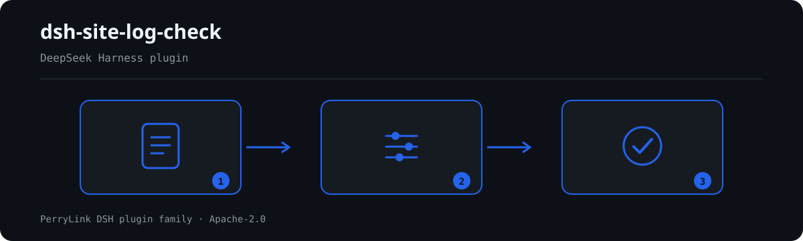

# dsh-site-log-check — Continuidade do registo diário de fiscalização de obra e cobertura dos registos de fiscalização no local

[English](README.md) · [简体中文](README-zh.md) · [Español](README-es.md) · [Português](README-pt.md) · [हिन्दी](README-hi.md)

```sh
dsh plugin --profile <name> add dsh-site-log-check
```


[](https://dsh.market/)
[](https://dshfind.com/en/plugins/PerryLink/dsh-site-log-check?ref=badge)

`dsh-site-log-check` lê o arquivo de fiscalização de uma obra —o período de serviço de fiscalização, os registos diários de fiscalização, a lista declarada de partes e processos-chave que exigem fiscalização no local e os próprios registos de fiscalização no local— e confronta-o com as cláusulas citadas pelo seu pacote de regras: se um mesmo dia de calendário tem mais de um registo ou um registo com data fora do período de serviço, que dias do período não têm registo, se cada registo preenche as suas colunas e indica quem o elaborou, se a lista declarada de partes e processos-chave existe e cada uma delas tem registo de fiscalização no local, se o registo de fiscalização no local traz hora de início e de fim por ordem, a parte e o processo-chave, a empresa construtora, o que foi encontrado e as assinaturas, e se a fiscalização no local declarada num registo diário tem registo na mesma data. Tudo o que reporta são diferenças literais, cada uma com a cláusula de onde vem, para revisão por uma pessoa.

## Install

```sh
dsh plugin --profile <name> add dsh-site-log-check
dsh --profile <name> --dump-config | grep 'dsh-site-log-check'
```

## Como é a saída



*Visão geral do fluxo: documento → regras → achados. Os exemplos abaixo usam a superfície real de comandos.*


Saída real deste plugin sobre o seu próprio fixture de teste `SL-014` — não é uma simulação. O pacote de regras não inventa citações, por isso cada achado nomeia a cláusula aplicada e avisa que o seu texto não foi obtido.

## O que ele responde

### Exemplos

A tabela abaixo é o conjunto de exemplos: a primeira linha é o caso detalhado e as demais são casos curtos.


| Você pergunta | O que ele responde |
|---|---|
| Dois registos diários trazem a mesma data de calendário — isso é reportado? | Sim. `SL-001` aplica `params.maxPerDay` (1) e assinala cada dia de calendário com mais de um registo; assinala também o registo cuja data fica fora do período de serviço obtido de `project.serviceStart` e `project.serviceEnd`. Compara datas e contagens; não decide qual dos dois lançamentos é o do dia nem se um lançamento acrescentado depois se justificava. Se nenhuma data do material for legível, a regra reporta que não pôde ser executada em vez de passar em silêncio. |
| Faltam três dias de registo a meio do período de serviço. O que faz a verificação? | `SL-002` conta os dias de calendário entre `project.serviceStart` e `project.serviceEnd` sem registo. É a única regra `info` do pacote: a exigência de datas consecutivas consta da norma provincial de Fujian DBJT 13-144-2019, não da GB/T 50319-2013, por isso avisa e nunca bloqueia. Abaixo de `params.minCoverageRatio` (0.9) lista cada dia em falta como diferença; nesse valor ou acima reporta que não pôde ser executada e nomeia aí os dias em falta. Se a falha foi uma paragem, um feriado ou um registo não arquivado, decide uma pessoa. |
| O registo de um dia deixa vazia a coluna dos problemas. | `SL-006` assinala esse lançamento: todos os registos diários devem preencher a coluna dos problemas do dia e da forma como foram resolvidos. Verifica que a coluna está preenchida, não que o texto está certo, pelo que uma anotação a dizer que nada foi encontrado passa e uma célula vazia não. O pacote regista que as duas leituras disponíveis do 第7.2.2条第4款 divergem na redação e que o documento oficial digitalizado não pôde ser relido, pelo que a regra abstém-se de propósito de julgar a redação e olha apenas para o preenchimento da coluna. |
| Nada no material declara que partes e processos-chave exigem fiscalização no local. Passa em silêncio? | Não. Quando o material mostra que houve fiscalização no local —existe um registo de fiscalização no local, ou a coluna do trabalho de fiscalização de algum registo diário menciona 旁站—, `SL-008` reporta a falta da lista declarada. Quando nada aponta para fiscalização no local, a regra reporta que não pôde ser executada com esse motivo, em vez de inventar uma exigência que a obra pode não ter. O pacote nota que o texto da GB/T 50319-2013 não enumera essas partes e processos, e que a lista vem do 建市〔2002〕189号第二条. |
| O nosso registo de fiscalização no local só tem a assinatura do fiscal. Isso é reportado? | Sim. Com `params.requireContractorSignature` ligado, `SL-011` assinala tanto a falta de assinatura do 旁站监理人员 como a do 施工企业现场质检人员. O pacote separa de propósito as duas bases: a 表 A.0.6 tem apenas a caixa 旁站监理人员（签字）, e a segunda assinatura vem do 建市〔2002〕189号第七条, pelo que não deve ser atribuída à GB/T 50319-2013. A regra verifica que as assinaturas estão registadas, não que sejam autênticas. |
| Um registo diário diz que houve fiscalização no local a 12 de maio, mas nesse dia o livro de registos não tem nada. | `SL-013` assinala-o: coteja as datas dos registos diários cuja coluna de fiscalização menciona 旁站 com as datas de início dos registos de fiscalização no local. Verifica apenas que ambos coincidem; o pacote afirma que nem a GB/T 50319-2013 nem o 建市〔2002〕189号 exigem que os dois documentos se liguem por número. Se nenhum registo de fiscalização no local tiver hora de início, ou nenhum registo diário declarar fiscalização no local, a regra reporta que não pôde ser executada em vez de passar em silêncio. |

## Normas que segue

| Documento | Número | Regras que o citam |
|---|---|---|
| 《建设工程监理规范》 | GB/T 50319-2013 | SL-001, SL-002, SL-003, SL-004, SL-005, SL-006, SL-007, SL-008, SL-009, SL-010, SL-011, SL-013, SL-014 |
| 福建省《建设工程监理文件资料管理标准》 | DBJT 13-144-2019 | SL-002 |
| 《建设工程质量管理条例》 | 国务院令第279号 | SL-008 |
| 《房屋建筑工程施工旁站监理管理办法（试行）》 | 建市〔2002〕189号 | SL-011, SL-012 |

**Boundary:** this plugin checks the **continuity of the daily supervision log and the coverage of
on-site supervision records** for a construction project — the site-supervision domain (工程监理).
It is not `dsh-archive-check` (which checks whether project records are complete for archiving), not
`dsh-hazplan-check` (which checks the sections of a plan for a hazardous sub-project), and not a
site-safety inspector. It reads a machine-readable export of the supervision office's own records and
reports literal mismatches against cited clauses.

## Compatibility

| Superfície | Estado |
|---|---|
| Harness | Faixa de peers `>=0.1.2-rc.1 <0.2.0 \|\| >=0.2.0-0 <0.3.0` — verificada para aceitar tanto `0.2.0-rc.2` quanto `0.2.1-rc.2`. **`engines.dsh` é declarado como `>=0.2.1-0 <0.3.0`** e o host o aplica desde 0.2.1 |
| Node | `^22.19.0 || >=24.0.0` |
| Plataformas | Todas (ESM puro; sem código nativo, sem rede, sem chamada ao modelo) |
| Modo de ferramenta | Funciona em `native` e `ptc`; para um diretório inteiro use `ptc` |

## What it does

A tabela de regras, os campos e o comportamento detalhado estão em [README.md](README.md#what-it-does) (versão principal em inglês). O plugin apenas lista divergências literais frente às cláusulas citadas e indica em `skipped` cada verificação que não pôde ser executada.

## Configuration

Todos os parâmetros ajustáveis ficam no esquema Schemastery de `src/config.ts`, portanto mudam pelo `cordis.yml` sem editar código; os limites por regra ficam no pacote de regras sob `rules/`.

| Chave | Tipo | Padrão | Descrição |
|---|---|---|---|
| `rulesFile` | string | `rules/site-log-check.yaml` | Caminho do pacote de regras, relativo à raiz do pacote |
| `disabledRules` | string[] | `[]` | Ids de regras a desativar; cada uma aparece em `skipped` |
| `onlyRules` | string[] | `[]` | Executar apenas estas regras; vazio executa todas |
| `skipNotes` | string | `""` | Nota acrescentada a cada motivo de `skipped` |
| `timeoutMs` | number | `120000` | Orçamento de tempo limite cooperativo da ferramenta |

## Material format

Aceita JSON ou YAML. O exemplo completo de campos está em [README.md](README.md#material-format) (versão principal em inglês). Os campos são opcionais na camada de leitura e validados pelo motor, de modo que uma exportação parcial gera achados sobre o que falta em vez de falhar.

## Rule sources

Os dados das regras ficam separados do código: cada regra traz documento, número, cláusula na numeração própria da fonte, trecho literal e URL de origem. O carregador impõe que o trecho seja citação real de pelo menos oito caracteres e que uma verificação baseada apenas em princípio geral (`kind: derived-from-principle`, teto `warn`) ou em política local (`kind: institutional-configuration`, teto `info`) nunca seja declarada `error`.

Os limites verificados e as conclusões deliberadamente **não** afirmadas estão em [README.md](README.md#rule-sources) (versão principal em inglês) e em `rules/evidence/`.

## Troubleshooting

- **O plugin instala mas a ferramenta não aparece**: confirme que `main` resolve para `lib/index.mjs` e que `pnpm run build` o gerou.
- **`dsh plugin add` recusa o pacote**: a faixa de peers cobre `0.1.x` e `0.2.x`; fora dela, conceda isenção explícita com `dsh plugin --profile <name> allow-version <pkg@ver> --dsh-version <runtime> --accept-risk`.
- **Uma regra não executou**: leia o arranjo `skipped`.
- **`check` informa `manifest-peers` como falha**: problema conhecido do `dsh-plugin-dev`; o runtime aplica a compatibilidade na instalação.
- **Os horários parecem deslocados**: toda a aritmética é de hora local sobre as cadeias fornecidas.

## Development

```sh
pnpm install
pnpm run typecheck
pnpm test
pnpm run build
node ../scripts/sync-shared.mjs dsh-site-log-check
```

O último comando copia o kit compartilhado de `../_shared` para `src/shared/`; execute-o novamente após cada alteração compartilhada.

## PerryLink DSH Plugin Family

Este projeto faz parte da família de plugins do DeepSeek Harness da [PerryLink](https://github.com/PerryLink). O registro fica recolhido abaixo para que cada README mantenha uma primeira tela curta; expanda para ver cada linha e seu status.

<details>
<summary>Expandir todos os plugins</summary>

| Plugin | Status |
|---|---|
| **[dsh-aqua-input-check](https://github.com/PerryLink/dsh-aqua-input-check)** |  |
| **[dsh-archive-check](https://github.com/PerryLink/dsh-archive-check)** |  |
| **[dsh-auto-review](https://github.com/PerryLink/dsh-auto-review)** |  |
| **[dsh-autotier](https://github.com/PerryLink/dsh-autotier)** |  |
| **[dsh-bid-ca-precheck](https://github.com/PerryLink/dsh-bid-ca-precheck)** |  |
| **[dsh-bid-qual-check](https://github.com/PerryLink/dsh-bid-qual-check)** |  |
| **[dsh-cert-mcp](https://github.com/PerryLink/dsh-cert-mcp)** |  |
| **[dsh-checkpoint-rewind](https://github.com/PerryLink/dsh-checkpoint-rewind)** |  |
| **[dsh-click](https://github.com/PerryLink/dsh-click)** |  |
| **[dsh-composer-history](https://github.com/PerryLink/dsh-composer-history)** |  |
| **[dsh-contract-stance](https://github.com/PerryLink/dsh-contract-stance)** |  |
| **[dsh-customs-doc-check](https://github.com/PerryLink/dsh-customs-doc-check)** |  |
| **[dsh-data-quality](https://github.com/PerryLink/dsh-data-quality)** |  |
| **[dsh-demurrage-ledger](https://github.com/PerryLink/dsh-demurrage-ledger)** |  |
| **[dsh-doublecheck](https://github.com/PerryLink/dsh-doublecheck)** |  |
| **[dsh-drill-script-check](https://github.com/PerryLink/dsh-drill-script-check)** |  |
| **[dsh-eia-guide-check](https://github.com/PerryLink/dsh-eia-guide-check)** |  |
| **[dsh-emergency-plan](https://github.com/PerryLink/dsh-emergency-plan)** |  |
| **[dsh-essay-rubric-check](https://github.com/PerryLink/dsh-essay-rubric-check)** |  |
| **[dsh-evidence-check](https://github.com/PerryLink/dsh-evidence-check)** |  |
| **[dsh-export-ctl-check](https://github.com/PerryLink/dsh-export-ctl-check)** |  |
| **[dsh-fast](https://github.com/PerryLink/dsh-fast)** |  |
| **[dsh-fmea-table-check](https://github.com/PerryLink/dsh-fmea-table-check)** |  |
| **[dsh-forecast-penalty](https://github.com/PerryLink/dsh-forecast-penalty)** |  |
| **[dsh-fund-research](https://github.com/PerryLink/dsh-fund-research)** |  |
| **[dsh-github](https://github.com/PerryLink/dsh-github)** |  |
| **[dsh-gongwen-flow-check](https://github.com/PerryLink/dsh-gongwen-flow-check)** |  |
| **[dsh-gongwen-word-check](https://github.com/PerryLink/dsh-gongwen-word-check)** |  |
| **[dsh-guard-plan-qc](https://github.com/PerryLink/dsh-guard-plan-qc)** |  |
| **[dsh-hazchem-check](https://github.com/PerryLink/dsh-hazchem-check)** |  |
| **[dsh-hazplan-check](https://github.com/PerryLink/dsh-hazplan-check)** |  |
| **[dsh-hidden-risk-map](https://github.com/PerryLink/dsh-hidden-risk-map)** |  |
| **[dsh-hs-classify](https://github.com/PerryLink/dsh-hs-classify)** |  |
| **[dsh-icd-rule-check](https://github.com/PerryLink/dsh-icd-rule-check)** |  |
| **[dsh-industry-research](https://github.com/PerryLink/dsh-industry-research)** |  |
| **[dsh-lawcite-adapter](https://github.com/PerryLink/dsh-lawcite-adapter)** |  |
| **[dsh-laya](https://github.com/PerryLink/dsh-laya)** |  |
| **[dsh-lc-doc-check](https://github.com/PerryLink/dsh-lc-doc-check)** |  |
| **[dsh-learning-gap-check](https://github.com/PerryLink/dsh-learning-gap-check)** |  |
| **[dsh-library](https://github.com/PerryLink/dsh-library)** |  |
| **[dsh-local-ai](https://github.com/PerryLink/dsh-local-ai)** |  |
| **[dsh-lsp-actions](https://github.com/PerryLink/dsh-lsp-actions)** |  |
| **[dsh-mask](https://github.com/PerryLink/dsh-mask)** |  |
| **[dsh-mcp-panel](https://github.com/PerryLink/dsh-mcp-panel)** |  |
| **[dsh-medrec-qc](https://github.com/PerryLink/dsh-medrec-qc)** |  |
| **[dsh-memento](https://github.com/PerryLink/dsh-memento)** |  |
| **[dsh-nsfc-form-check](https://github.com/PerryLink/dsh-nsfc-form-check)** |  |
| **[dsh-nurse-record-check](https://github.com/PerryLink/dsh-nurse-record-check)** |  |
| **[dsh-observe](https://github.com/PerryLink/dsh-observe)** |  |
| **[dsh-origin-rvc-check](https://github.com/PerryLink/dsh-origin-rvc-check)** |  |
| **[dsh-ota-review-check](https://github.com/PerryLink/dsh-ota-review-check)** |  |
| **[dsh-output-styles](https://github.com/PerryLink/dsh-output-styles)** |  |
| **[dsh-paper-doc-adapter](https://github.com/PerryLink/dsh-paper-doc-adapter)** |  |
| **[dsh-permission-rules](https://github.com/PerryLink/dsh-permission-rules)** |  |
| **[dsh-permit-report-check](https://github.com/PerryLink/dsh-permit-report-check)** |  |
| **[dsh-pipeline-check](https://github.com/PerryLink/dsh-pipeline-check)** |  |
| **[dsh-pleading-draft](https://github.com/PerryLink/dsh-pleading-draft)** |  |
| **[dsh-plugin-doctor](https://github.com/PerryLink/dsh-plugin-doctor)** |  |
| **[dsh-plugin-guide](https://github.com/PerryLink/dsh-plugin-guide)** |  |
| **[dsh-plugin-kit](https://github.com/PerryLink/dsh-plugin-kit)** |  |
| **[dsh-plugin-upgrade](https://github.com/PerryLink/dsh-plugin-upgrade)** |  |
| **[dsh-policy-brief-draft](https://github.com/PerryLink/dsh-policy-brief-draft)** |  |
| **[dsh-power-loss-split](https://github.com/PerryLink/dsh-power-loss-split)** |  |
| **[dsh-power-ticket-check](https://github.com/PerryLink/dsh-power-ticket-check)** |  |
| **[dsh-ppap-check](https://github.com/PerryLink/dsh-ppap-check)** |  |
| **[dsh-protest-deadline](https://github.com/PerryLink/dsh-protest-deadline)** |  |
| **[dsh-railway-window](https://github.com/PerryLink/dsh-railway-window)** |  |
| **[dsh-repair-order-qc](https://github.com/PerryLink/dsh-repair-order-qc)** |  |
| **[dsh-research-report](https://github.com/PerryLink/dsh-research-report)** |  |
| **[dsh-review-reply-check](https://github.com/PerryLink/dsh-review-reply-check)** |  |
| **[dsh-rulefile-check](https://github.com/PerryLink/dsh-rulefile-check)** |  |
| **[dsh-safety-brief-check](https://github.com/PerryLink/dsh-safety-brief-check)** |  |
| **[dsh-score](https://github.com/PerryLink/dsh-score)** |  |
| **[dsh-session-sync](https://github.com/PerryLink/dsh-session-sync)** |  |
| **[dsh-site-log-check](https://github.com/PerryLink/dsh-site-log-check)** |  |
| **[dsh-skill-pack-security](https://github.com/PerryLink/dsh-skill-pack-security)** |  |
| **[dsh-soe-decision-check](https://github.com/PerryLink/dsh-soe-decision-check)** |  |
| **[dsh-soilwater-check](https://github.com/PerryLink/dsh-soilwater-check)** |  |
| **[dsh-sop-sync-check](https://github.com/PerryLink/dsh-sop-sync-check)** |  |
| **[dsh-spc-gbt-adapter](https://github.com/PerryLink/dsh-spc-gbt-adapter)** |  |
| **[dsh-talk](https://github.com/PerryLink/dsh-talk)** |  |
| **[dsh-tender-extract](https://github.com/PerryLink/dsh-tender-extract)** |  |
| **[dsh-tender-matrix](https://github.com/PerryLink/dsh-tender-matrix)** |  |
| **[dsh-test-drive](https://github.com/PerryLink/dsh-test-drive)** |  |
| **[dsh-ticktick](https://github.com/PerryLink/dsh-ticktick)** |  |
| **[dsh-translate](https://github.com/PerryLink/dsh-translate)** |  |
| **[dsh-warranty-calc](https://github.com/PerryLink/dsh-warranty-calc)** |  |
| **[dsh-budget](https://github.com/PerryLink/dsh-budget)** | 🧊 CONGELADO — ver o README do repositório |
| **[dsh-claude-move](https://github.com/PerryLink/dsh-claude-move)** | 🧊 CONGELADO — ver o README do repositório |
| **[dsh-defend](https://github.com/PerryLink/dsh-defend)** | 🧊 CONGELADO — ver o README do repositório |
| **[dsh-draw](https://github.com/PerryLink/dsh-draw)** | 🧊 CONGELADO — ver o README do repositório |
| **[dsh-reach](https://github.com/PerryLink/dsh-reach)** | 🧊 CONGELADO — ver o README do repositório |
| **[dsh-background-agents](https://github.com/PerryLink/dsh-background-agents)** | 🚫 RETIRADO — ver o README do repositório |
| **[dsh-session-pin](https://github.com/PerryLink/dsh-session-pin)** | 🚫 RETIRADO — ver o README do repositório |
| **[dsh-team-rooms](https://github.com/PerryLink/dsh-team-rooms)** | 🚫 RETIRADO — ver o README do repositório |

</details>

## License

[Apache License 2.0](LICENSE) © 2026 dsh-site-log-check contributors.
