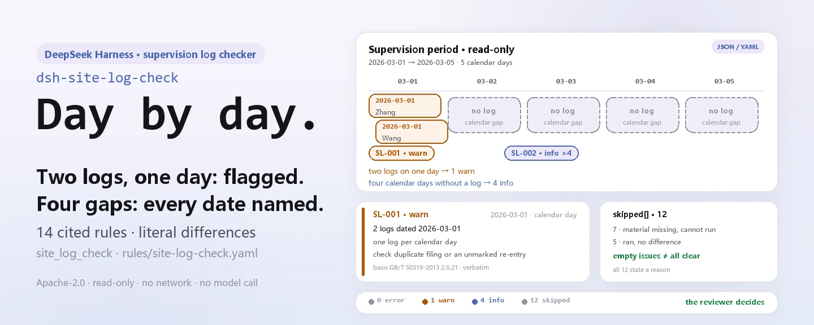

<div align="center">

<picture>
  <source media="(prefers-color-scheme: dark)" srcset="docs/assets/dsh-site-log-check-hero-en-dark.webp">
  
</picture>

# dsh-site-log-check

**Point every missing day, duplicate log and uncovered on-site supervision record at the exact date, column and cited clause.**

A DeepSeek Harness checker for supervising engineers and chief representatives: hand it a machine-readable export of one project's supervision records, and 14 rules with clause-level citations list the literal differences — no compliance verdict, no liability finding, no change to the original.

[Install](#three-step-setup) · [Configuration](#configuration) · [FAQ](#faq) · [简体中文](README.md) · [English](README.en.md) · [Español](README.es.md) · [Português](README.pt.md) · [हिन्दी](README.hi.md)

[](LICENSE)
[](#compatibility)
[](https://www.npmjs.com/package/dsh-site-log-check)
[](https://github.com/PerryLink/dsh-site-log-check/actions/workflows/ci.yml)
[](#compatibility)

[](https://github.com/PerryLink/dsh-site-log-check/stargazers)
[](https://www.npmjs.com/package/dsh-site-log-check)
[](https://dshfind.com/plugins/PerryLink/dsh-site-log-check?ref=badge)
[](https://securityscorecards.dev/viewer/?uri=github.com/PerryLink/dsh-site-log-check)
[](https://dsh.market/)
[](https://gitee.com/perrylink/dsh-site-log-check)

```sh
dsh plugin --profile <name> add dsh-site-log-check
```

</div>

<sub>Community plugin, not affiliated with DeepSeek. Canonical repository: <https://github.com/PerryLink/dsh-site-log-check> (Gitee is a mirror).</sub>

## What it is

`dsh-site-log-check` reads one construction project's supervision archive — the supervision service period, the daily supervision logs, the declared list of key parts and key processes that require on-site supervision, and the on-site supervision records themselves — and checks it against the clauses its rule pack cites: whether one calendar day carries more than one log or a log dated outside the service period, which days of the period have no log, whether each log fills its content columns and names a recorder, whether the declared key-work list exists and every declared item has an on-site record, whether an on-site record carries start and end times in order, its key part and process, its contractor, what was found and the signatures, and whether on-site supervision claimed in a log is matched by an on-site record on the same date. Every difference it reports is literal and carries the clause it came from, and the report lists those differences for a human to review.

**Boundary:** this plugin checks the **continuity of the daily supervision log and the coverage of on-site supervision records** for a construction project — the site-supervision domain (engineering supervision). It is not `dsh-archive-check` (which checks whether project records are complete for archiving), not `dsh-hazplan-check` (which checks the sections of a plan for a hazardous sub-project), and not a site-safety inspector. It reads a machine-readable export of the supervision office's own records and reports literal mismatches against cited clauses.

<picture>
  <source media="(prefers-color-scheme: dark)" srcset="docs/assets/dsh-site-log-check-flow-v5-dark.svg">
  
</picture>

## Three-step setup

1. **Install** (pick one channel):

   ```sh
   # npm channel (published releases)
   dsh plugin --profile web add dsh-site-log-check
   # git channel (latest main; the install runs the tsdown step from package.json#prepare to produce lib/)
   dsh plugin --profile web add github:PerryLink/dsh-site-log-check
   # tarball channel: pnpm pack in this repo, then
   dsh plugin --profile web add ./dsh-site-log-check-<version>.tgz
   ```

   It can also be found as part of the "Professional Document Check Suite" on WorkBuddy / Coze — the suite bundles this check; listing follows each marketplace.

2. **Minimal config** (the defaults are usable):

   ```yaml
   - insert:
       - id: dsh-site-log-check
         name: dsh-site-log-check
   ```

   Every tunable lives in the Schemastery schema in `src/config.ts`; per-rule thresholds live in `rules/site-log-check.yaml`.

3. **Verify it mounts**:

   ```sh
   dsh --profile <name> --dump-config | grep 'dsh-site-log-check'
   ```

   Then run the bundled quickstart (about a minute; the script imports `lib/index.mjs`, so build first):

   ```sh
   pnpm install && pnpm run build
   node samples/quickstart/run.mjs
   ```

   ```text
   $ node samples/quickstart/run.mjs
   site_log_check: 5 issue(s) — error 0, warn 1, info 4
   skipped: 12
   ```

   The sample input is `samples/quickstart/input/SL-001-unsafe.yaml` and the expected output is `samples/quickstart/expected/result.json`; `node samples/quickstart/run.mjs --json` prints the same summary as JSON.

**Uninstall**: `dsh plugin --profile <name> remove dsh-site-log-check` (or remove the row from the profile patch).

<details>
<summary>Install from the DSH Desktop market</summary>

Every PerryLink plugin is listed in the built-in DSH Desktop market: **Market → Sources → Add source → paste** `https://perrylink-dsh-catalog.perrylink.workers.dev/catalog-source.json` **→ select**. Installation still requires the market's npm identity check and your confirmation.

</details>

## Core capabilities

The plugin registers the `site_log_check` tool: it reads one supervision archive (JSON or YAML), applies a versioned rule pack, and returns a structured report — every finding carries `found` / `expected` / `fix` plus the clause it came from.

- **The rule pack is data, not code** — all 14 rules live in `rules/site-log-check.yaml`; swapping the file switches the rule set without touching TypeScript, and the pack is validated on load, not trusted.
- **Severity follows the evidence** — a rule resting on a general principle (`derived-from-principle`) is capped at `warn`; one resting on your institution's own configuration (`institutional-configuration`) is capped at `info`; neither can ever be declared `error` (a test asserts this).
- **An empty issue list is never "all clear"** — every check that could not run reports itself in `skipped` with its rule id and reason, and a rule whose required list is unset reports itself in `skipped` rather than passing silently.
- **No adjudication** — the report lists differences and never pronounces on compliance, liability or correctness; a wording guard blocks adjudicating terms and the report always carries the disclaimer.
- **Verbatim citations only** — every rule carries a document, a document number, a clause in the source's own numbering, a verbatim excerpt of at least eight characters and the URL it was read from; when the text could not be obtained the excerpt says so and the rule is marked `derived-from-principle` — a paraphrase is never presented as a quotation.
- **Three delivery forms** — each run returns `markdown` (for the model to read), `reportJson` (machine-readable) and `workbookBase64` (an xlsx with three sheets: summary, findings, and checks that did not run), so the result can be attached to the record.

```text
supervision material (period · logs · key-works list · on-site records) ──site_log_check──▶ rule pack SL-001…SL-014 ──▶ report (findings + skipped)
        ▲                                                                                                            │
        └──────────────────────────────── input is read-only, the original is never modified ─────────────────────────┘
```

### Rules at a glance

| Rule | Check | Severity | Basis |
|---|---|---|---|
| `SL-001` | one log per calendar day, inside the service period | warn | GB/T 50319-2013 clause 2.0.21 |
| `SL-002` | no calendar day in the service period lacks a log | info | GB/T 50319-2013 clause 2.0.21 · DBJT 13-144-2019 7.1.1 |
| `SL-003` | the log records weather and site conditions | warn | GB/T 50319-2013 clause 7.2.2 item 1 |
| `SL-004` | the log records the day's construction progress | warn | GB/T 50319-2013 clause 7.2.2 item 2 |
| `SL-005` | the log records the day's supervision work | warn | GB/T 50319-2013 clause 7.2.2 item 3 |
| `SL-006` | the log records the day's problems **and how they were handled** | warn | GB/T 50319-2013 clause 7.2.2 item 4 |
| `SL-007` | the log names the person who compiled it | warn | GB/T 50319-2013 clause 3.2.3 item 10 |
| `SL-008` | the project has a declared list of key parts and processes requiring on-site supervision | warn | GB/T 50319-2013 clause 5.2.11 · State Council Order No. 279 Article 38 |
| `SL-009` | an on-site record carries start and end times, in order | warn | GB/T 50319-2013 Table A.0.6 |
| `SL-010` | an on-site record states what was found and how it was handled | warn | GB/T 50319-2013 Table A.0.6 |
| `SL-011` | an on-site record is signed, and not by one side only | warn | GB/T 50319-2013 Table A.0.6 · Jianshi [2002] No. 189 Article 7 |
| `SL-012` | every declared key part and process has at least one on-site record | warn | Jianshi [2002] No. 189 Articles 2 and 9 |
| `SL-013` | on-site supervision claimed in a log matches the on-site record ledger | warn | GB/T 50319-2013 clause 7.2.2 item 3 |
| `SL-014` | an on-site record names the key part or process and the contractor | warn | GB/T 50319-2013 Table A.0.6 |

The pack has no `error`-level rule; the reason is in "Standards it follows".

### Examples

These are the plugin's real entry points; install once, then call one.

**Detailed output** — tool `site_log_check`, input:

```yaml
project:
  serviceStart: "2026-03-01"
  serviceEnd: "2026-03-05"
logs:
  - date: "2026-03-01"
  - date: "2026-03-05"
```

Output:

```json
{
  "id": "dsh-site-log-check.SL-002.378ce636",
  "ruleId": "SL-002",
  "severity": "info",
  "locator": {
    "cell": "2026-03-02"
  },
  "found": "2026-03-02 无监理日志记录",
  "expected": "监理服务期 2026-03-01 ~ 2026-03-05 内应按日历日记录",
  "fix": "核对是否因停工、节假日或日志未归档；确无施工活动的应有说明"
}
```

*Observed from `dsh-site-log-check/tests/fixtures/SL-002/SL-002-unsafe.yaml`*

**Brief example**: `site_log_check` · `only: ["SL-001"]` · `rulesFile: rules/site-log-check.yaml` (override the rule pack per call for a one-off comparison).

### What it answers

| You ask | What it answers |
|---|---|
| Two log entries carry the same calendar date — is that reported? | Yes. `SL-001` applies `params.maxPerDay` (1) and reports every calendar day that carries more than one log; it also reports a log whose date falls outside the service period taken from `project.serviceStart` and `project.serviceEnd`. It compares dates and counts; it does not decide which of the two entries is that day's record, nor whether an entry added later was justified. If no log date in the material can be read, the rule reports itself in `skipped` instead of passing. |
| Three days in the middle of the service period have no log. What does the check do? | `SL-002` counts the calendar days between `project.serviceStart` and `project.serviceEnd` that have no log. It is the pack's only `info` rule: the requirement that dates run consecutively comes from the Fujian standard DBJT 13-144-2019, not from GB/T 50319-2013, so it flags and never blocks. Below `params.minCoverageRatio` (0.9) it lists each missing day as a finding; at or above that ratio it reports itself in `skipped` and names the missing days there. Whether a gap was a stoppage, a holiday or a log that was never archived is left to a human. |
| A day's log leaves the problems column empty. | `SL-006` reports that entry: every log must fill the column for the day's problems and how they were handled. It checks that the column is filled, not that the text is right, so an entry saying that nothing was found passes while a blank one does not. The pack records that the two available readings of clause 7.2.2 item 4 differ in wording and that the official scan could not be re-read, so the rule deliberately stays silent on the wording and looks only at whether the column is filled. |
| Nothing in the material declares which key parts and processes require on-site supervision. Does that pass silently? | No. When the material shows on-site supervision was in play — an on-site record exists, or a log's supervision column mentions on-site supervision — `SL-008` reports the missing declared list. When nothing points to on-site supervision at all, the rule reports itself in `skipped` with that reason instead of inventing a requirement the project may not be subject to. The pack notes that the text of GB/T 50319-2013 does not itself list the key works and that the list comes from Jianshi [2002] No. 189 Article 2. |
| Our on-site record is signed only by the supervision engineer. Is that reported? | Yes. With `params.requireContractorSignature` on, `SL-011` reports both a missing signature from the on-site supervising officer and a missing signature from the contractor's site quality inspector. The pack keeps the two bases apart on purpose: Table A.0.6 carries only the signature column for the on-site supervising officer, and the second signature comes from Jianshi [2002] No. 189 Article 7, so it must not be attributed to GB/T 50319-2013. The rule checks that the signatures are recorded; it does not check that they are genuine. |
| A log says on-site supervision happened on 12 May, but the ledger has no record for that date. | `SL-013` reports it: it matches the dates of logs whose supervision column mentions on-site supervision against the dates on which the on-site records start. It checks only that the two line up; the pack states that neither GB/T 50319-2013 nor Jianshi [2002] No. 189 requires the two documents to cross-reference each other's serial numbers. If no on-site record carries a start time, or no log claims on-site supervision, the rule reports itself in `skipped` instead of passing. |

## Configuration

Every tunable lives in the Schemastery schema in `src/config.ts`, so it can be changed from `cordis.yml` without editing code; per-rule thresholds live in the rule pack under `rules/`. The five keys below are the complete list; rule-level parameters follow.

| Key | Type | Default | Description |
|---|---|---|---|
| `rulesFile` | string | `rules/site-log-check.yaml` | Rule-pack path, relative to the package root |
| `disabledRules` | string[] | `[]` | Rule ids to stop running; each appears in `skipped` |
| `onlyRules` | string[] | `[]` | Run only these rule ids; empty runs every rule |
| `skipNotes` | string | `""` | Note appended to every `skipped` reason, e.g. your institution's implementing rules |
| `timeoutMs` | number | `120000` | Cooperative tool timeout budget |

Rule-level parameters worth knowing:

- `SL-001` `maxPerDay` — how many logs one calendar day may carry; default `1`.
- `SL-002` `minCoverageRatio` (default `0.9`) and `ignoreWeekends` (default `false`) — once coverage is at or above the ratio the rule reports through `skipped` and lists the missing days there instead of one finding per day.
- `SL-009` `requireEndTime` (default `true`) — set to `false` to stop requiring an end time.
- `SL-011` `requireContractorSignature` (default `true`) — set to `false` if your contract does not apply the two-party signature rule.
- `SL-012` `keyWorks` — the catalogue of key parts and processes, by default verbatim from Jianshi [2002] No. 189 Article 2; that article covers **housing construction** only, while other disciplines refer to it under Article 12 of the same measures, so replace the list.

Example override in your profile patch:

```yaml
- insert:
    - id: dsh-site-log-check
      name: dsh-site-log-check
      config:
        onlyRules: [SL-001, SL-002]
        skipNotes: implementing rules of this institution, 2026 edition
```

## FAQ

<details>
<summary>Is my material modified or uploaded anywhere?</summary>

No. The tool only reads the JSON/YAML you hand it (`file` or `material`) and **never modifies the original**; the plugin is plain ESM with no native code, **no network access and no model call** (see Compatibility), and `package.json#dsh.demo` declares `network: false` with `writes: []`. The xlsx in the report is a `workbookBase64` field — you decide whether to save it, and the plugin writes nothing to disk.

</details>

<details>
<summary>Can an empty difference list be read as "nothing is wrong"?</summary>

No. An empty list only means the rules that **did run** found no difference; a rule that could not run reports its id and reason in `skipped`. The bundled quickstart is the demonstration: two logs, no declared key-work list and no on-site records produce 1 `warn` and 4 `info` findings plus 12 skipped checks. The report always carries the disclaimer stating that it is not an opinion on any fact, act or document.

</details>

<details>
<summary>Does it fight other plugins over tool names, commands or routes?</summary>

No. It registers one namespaced tool, `site_log_check`, and its `inject` declares only `tools`; it provides no service key, registers no client slot and no `webServer` route, and its bundle patch only `insert`s its own row without overriding a built-in row's `config`. Registration is a Cordis effect, so unloading or hot-reloading removes it.

</details>

<details>
<summary>Can it handle a batch of projects?</summary>

Yes. The check core is a pure function: a file read plus string comparisons across 14 rules, with no network requests and no model calls; `timeoutMs` is the cooperative budget (default 120000 ms). The tool works in both `native` and `ptc` mode; for a whole directory use `ptc`, so the schema cost is paid once.

</details>

<details>
<summary>Our local standard or institutional rules are stricter — can they be plugged in?</summary>

Yes, and without touching code: point `rulesFile` at your own YAML. The basis kind caps the severity — general-principle reasoning (`derived-from-principle`) at `warn`, institutional thresholds (`institutional-configuration`) at `info` — so the pack never produces `error`, and an excerpt must still be a verbatim quotation of at least eight characters.

</details>

## Standards it follows

| Document | Number | Cited by rules |
|---|---|---|
| Code of practice for construction supervision | GB/T 50319-2013 | SL-001, SL-002, SL-003, SL-004, SL-005, SL-006, SL-007, SL-008, SL-009, SL-010, SL-011, SL-013, SL-014 |
| Fujian standard for the management of construction supervision documents | DBJT 13-144-2019 | SL-002 |
| Regulation on the quality management of construction projects | State Council Order No. 279 | SL-008 |
| Measures for the administration of on-site supervision of key works in housing construction (trial) | Jianshi [2002] No. 189 | SL-011, SL-012 |

Original titles of the cited documents:

```text
《建设工程监理规范》 GB/T 50319-2013
福建省《建设工程监理文件资料管理标准》 DBJT 13-144-2019
《建设工程质量管理条例》 国务院令第279号
《房屋建筑工程施工旁站监理管理办法（试行）》 建市〔2002〕189号
```

> ### ⚠️ Nothing here is `error`, because the standard is *recommended*
>
> **GB/T 50319-2013 is a recommended national standard** — Ministry of Housing and Urban-Rural
> Development Announcement No. 35 approves it as a “national standard, **numbered GB/T
> 50319-2013**”, and its foreword **declares no chapter mandatory**. Contrast **GB 26860—2011**,
> whose foreword states outright that “Chapter 5 and 7.3.4 are recommendatory, **the rest
> mandatory**”. The “shall” wording inside these clauses is engineering drafting convention,
> **not legal compulsion**, so every rule is capped at `warn` and **this plugin blocks nothing**.
>
> That is not a claim that the requirements are unimportant: **the supervision log and on-site
> supervision are statutory duties under the Regulation on the quality management of construction
> projects**. But the standard carrying the *specific clauses checked here* is recommendatory, so
> the plugin flags rather than blocks.

## Material format

The tool accepts JSON or YAML. Fields are optional at the reader level and validated by the check engine, so a partial export produces findings about the missing parts instead of a crash.

```yaml
target: 某住宅楼工程 监理日志与旁站记录
project:
  name: 某住宅楼工程
  serviceStart: "2026-03-01"
  serviceEnd: "2026-03-05"
logs:
  - date: "2026-03-01"
    weather: 晴，具备施工条件
    progress: 三层顶板钢筋绑扎完成 80%
    supervision: 巡视 2 次；旁站混凝土浇筑 1 次
    issues: 个别箍筋间距偏大，已要求班组整改并复查
    recorder: 张监理
keyWorks:
  - name: 土方回填
    contractor: 某基础工程公司
onsite:
  - id: PZ-0001
    keyWork: 混凝土浇筑
    contractor: 某建筑公司
    startedAt: "2026-03-04 08:00"
    endedAt: "2026-03-04 12:30"
    issues: 未发现问题；坍落度经检测符合要求
    supervisorSignature: 张监理
    contractorSignature: 李质检
```

- `project.serviceStart` / `project.serviceEnd` define the supervision period that `SL-001`, `SL-002` and `SL-013` measure against.
- `logs[]` carries `weather` / `progress` / `supervision` / `issues` / `recorder`, checked by `SL-003` through `SL-007`.
- `keyWorks[]` is the declared list: `SL-008` checks that it exists and `SL-012` that every item has an on-site record.
- `onsite[]` carries `startedAt` / `endedAt` for `SL-009`, `issues` for `SL-010`, both signatures for `SL-011`, and `keyWork` / `contractor` for `SL-014`.

## Rule sources

Rule data lives in `rules/site-log-check.yaml`, separate from the code. Every rule carries a document, a document number, a clause in the source's own numbering, a verbatim excerpt and the URL the excerpt was read from. The loader enforces that an excerpt is a real quotation of at least eight characters, and that a check resting only on a general principle (`kind: derived-from-principle`, capped at `warn`) or on an institutional setting (`kind: institutional-configuration`, capped at `info`) can **never** be declared `error`. A pack that overstates its basis fails at load instead of producing a confident-looking report.

The clause numbers were checked against the full text of GB/T 50319-2013 and Jianshi [2002] No. 189. Three findings shaped the pack, and are recorded here so a reviewer can see what was deliberately **not** claimed:

1. **"Daily continuity" has no national clause.** GB/T 50319-2013 says only “daily” in its definition of the supervision log (clause 2.0.21). The words “dates shall be continuous” come from the Fujian provincial standard DBJT 13-144-2019, a *local* standard, which is why `SL-002` is capped at `info`.
2. **Two-party signatures are not a 50319 requirement.** Table A.0.6 has a single signature column, for the on-site supervising officer. The requirement that the contractor's quality inspector also signs comes from Jianshi [2002] No. 189 Article 7, and `SL-011` cites both documents separately rather than merging them.
3. **A daily signature and the chief supervisor's review are local requirements.** They come from Shandong DB37/T 5009, not from the national standard, so the pack checks only that a compiler is named (`SL-007`) and does not invent a signing obligation.

The key-work catalogue in `SL-012` was also checked character by character against Jianshi [2002] No. 189 Article 2. The full clause-verification record, including the sources that were checked and rejected, is in `rules/evidence/`.

## Known limitations

- **Literal, machine-decidable items only.** It does not decide whether a late entry was justified, whether a gap was a stoppage, a holiday or a missing archive copy, whether a signature is genuine, or whether the text inside a column is correct — those are left to a person.
- **No `error`-level rule.** The standard carrying the specific clauses checked here, GB/T 50319-2013, is a recommended national standard, so all 14 rules land at `warn` or `info`; the obligation itself sits in Article 38 of the Regulation on the quality management of construction projects, while the practice sits in a recommendatory standard.
- **The continuity threshold is an institutional setting.** `SL-002`'s `minCoverageRatio` (default `0.9`) only moves the missing days into `skipped` once coverage is at or above the ratio instead of listing each day; `ignoreWeekends` defaults to `false`, so weekends count too.
- **The `SL-012` key-work catalogue covers housing construction only.** It is verbatim from Jianshi [2002] No. 189 Article 2; other disciplines refer to those measures under Article 12 and should replace `keyWorks`.
- **Two readings of clause 7.2.2 item 4 coexist.** The two available sources word it differently and the official scan could not be re-read this round, so `SL-006` checks only that the column is filled and says nothing about the wording — a boundary of the check, not a claim that either reading is wrong.
- **A daily signature and the chief supervisor's review are not in the national standard.** They come from Shandong DB37/T 5009; the plugin checks only that a recorder is named and does not invent a signing obligation.
- **Dates are wall-clock string arithmetic.** All arithmetic is wall-clock over the input strings, with no timezone conversion.

## Compatibility

| Surface | Status |
|---|---|
| Harness | Peer range `>=0.1.2-rc.1 <0.2.0 \|\| >=0.2.0-0 <0.3.0` — verified to accept both `0.2.0-rc.2` and `0.2.1-rc.2`. `engines.dsh` is declared as `>=0.2.1-0 <0.3.0` and is enforced by the host since 0.2.1 |
| Node | `^22.19.0 \|\| >=24.0.0` |
| Platforms | All (plain ESM; no native code, no network, no model call) |
| Tool mode | Works in `native` and `ptc`; for a batch of checkers use `ptc`, so the schema cost is paid once |

## Troubleshooting

- **The plugin installs but the tool never appears.** Check that `main` resolves to `lib/index.mjs` and that `pnpm run build` produced it; a wrong `main` makes the loader skip the entry silently.
- **`dsh plugin add` refuses the package as incompatible.** The peer range covers `0.1.x` and `0.2.x`; if your runtime sits outside it, grant an explicit exemption: `dsh plugin --profile <name> allow-version dsh-site-log-check@0.1.0 --dsh-version <runtime> --accept-risk`.
- **`SL-002` reports nothing.** Coverage is still above `minCoverageRatio`, so the missing days are named in that rule's `skipped` entry; lower the ratio if you want each gap as a finding.
- **A rule did not run.** Read the "checks that did not run" list at the end of the report; it names the rule id and the reason (disabled, list unset, no usable input).
- **`check` reports `manifest-peers` as failed.** The static checker compares against a hard-coded peer range that predates the 0.2 line. The runtime enforces peer compatibility at install time, so the declared range is the correct one; this is a known upstream issue in `dsh-plugin-dev`.
- **A finding says the clause text was not obtained.** The pack never invents clause text: when the verbatim text is unavailable the rule stays at `warn` / `info` and says so in its `excerpt`. Treat that as a verification gap, not as evidence that the document is fine.
- **Times look shifted.** All arithmetic is wall-clock over the input strings, with no timezone conversion.

## Ecosystem and quality

- [Gitee mirror](https://gitee.com/perrylink/dsh-site-log-check) (synced mirror; GitHub is canonical)
- [dshfind plugin page](https://dshfind.com/plugins/PerryLink/dsh-site-log-check) (installs and ranking)
- [OpenSSF Scorecard report](https://securityscorecards.dev/viewer/?uri=github.com/PerryLink/dsh-site-log-check) (driven by [.github/workflows/scorecard.yml](.github/workflows/scorecard.yml))
- [DSH Market](https://dsh.market/) (listed)
- [Ecosystem knowledge base — choose a checker by material](https://perrylink.github.io/zh/checkers/choose/) (full family index: 62 checkers + general plugins)

## Development

```sh
pnpm install
pnpm run typecheck        # tsc --noEmit
pnpm test                 # vitest, paired fixtures per rule (tests/fixtures/<RULE>/)
pnpm run build            # tsdown -> lib/index.mjs + lib/index.d.mts
pnpm run verify:self-contained   # dependency specs resolve from the registry
pnpm run check:lockfile   # pnpm-lock did not drift
pnpm run check:readmes    # five-language README consistency
pnpm run check:citations  # every excerpt (including alsoBasis) is a verbatim quotation
pnpm pack                 # the published tarball
node ../scripts/sync-shared.mjs dsh-site-log-check   # refresh src/shared from ../_shared
```

Layout:

| Path | Role |
|---|---|
| `src/index.ts` | function-plugin contract (`name` / `inject` / `Config` / `apply`); registers the `site_log_check` tool |
| `src/config.ts` | Schemastery schema; every tunable lives here, no hard-coded thresholds |
| `src/check.ts` | the pure check core `(input, ruleset, options) => Report`: no plugin context, no I/O, no clock |
| `src/parse.ts` | reader for the canonical material (JSON or YAML) |
| `src/view.ts` | the model-facing projection of a report; `output.schema` mirrors it |
| `src/shared/` | shared kit (ruleset loader, report shape, YAML subset, calendar arithmetic, wording guard); copied in so the package stays self-contained |
| `rules/site-log-check.yaml` | the rule pack, 14 rules |
| `rules/evidence/` | the clause-verification record for every citation |
| `tests/` | vitest; every rule has a paired compliant/violating fixture under `tests/fixtures/<RULE>/` |
| `samples/quickstart/` | a re-runnable quickstart (input plus expected output) |

The rule pack is data, not code: edit `rules/*.yaml` to switch the rule set without touching TypeScript; the pack is validated on load, not trusted. README images are generated programmatically by [`scripts/gen-readme-assets.py`](scripts/gen-readme-assets.py) (Python + Pillow): the hero is a 1440×576 WebP in four variants (zh/en × light/dark), the structure diagram is a hand-written SVG pair (light + dark), and both can be re-run safely; this plugin has no UI, so the figures draw only the material surfaces, rule gates and report channels.

Topics: `dsh`, `dsh-plugin`, `deepseek-harness`, `deepseek`, `cordis`, `site`, `log`

## Family and credits

This project is part of the DeepSeek Harness plugin family maintained by [PerryLink](https://github.com/PerryLink) (all Apache-2.0). If this plugin helps you, **a star** unlocks nothing but makes it easier for the next person to find.

- [@PerryLink](https://github.com/PerryLink) — creator and maintainer: the `site_log_check` tool, the verbatim-citation rule pack and its clause-verification record (`rules/evidence/`), and the five-language docs.

<details>
<summary>Expand all plugins</summary>

| Plugin | Status |
|---|---|
| **[dsh-aqua-input-check](https://github.com/PerryLink/dsh-aqua-input-check)** |  |
| **[dsh-archive-check](https://github.com/PerryLink/dsh-archive-check)** |  |
| **[dsh-auto-review](https://github.com/PerryLink/dsh-auto-review)** |  |
| **[dsh-autotier](https://github.com/PerryLink/dsh-autotier)** | 🧊 FROZEN — see the repo README |
| **[dsh-bid-ca-precheck](https://github.com/PerryLink/dsh-bid-ca-precheck)** |  |
| **[dsh-bid-qual-check](https://github.com/PerryLink/dsh-bid-qual-check)** |  |
| **[dsh-cert-mcp](https://github.com/PerryLink/dsh-cert-mcp)** | 🧊 FROZEN — see the repo README |
| **[dsh-checkpoint-rewind](https://github.com/PerryLink/dsh-checkpoint-rewind)** |  |
| **[dsh-click](https://github.com/PerryLink/dsh-click)** |  |
| **[dsh-composer-history](https://github.com/PerryLink/dsh-composer-history)** |  |
| **[dsh-contract-stance](https://github.com/PerryLink/dsh-contract-stance)** |  |
| **[dsh-customs-doc-check](https://github.com/PerryLink/dsh-customs-doc-check)** |  |
| **[dsh-data-quality](https://github.com/PerryLink/dsh-data-quality)** | 🧊 FROZEN — see the repo README |
| **[dsh-demurrage-ledger](https://github.com/PerryLink/dsh-demurrage-ledger)** |  |
| **[dsh-doublecheck](https://github.com/PerryLink/dsh-doublecheck)** |  |
| **[dsh-drill-script-check](https://github.com/PerryLink/dsh-drill-script-check)** |  |
| **[dsh-eia-guide-check](https://github.com/PerryLink/dsh-eia-guide-check)** |  |
| **[dsh-emergency-plan](https://github.com/PerryLink/dsh-emergency-plan)** |  |
| **[dsh-essay-rubric-check](https://github.com/PerryLink/dsh-essay-rubric-check)** |  |
| **[dsh-evidence-check](https://github.com/PerryLink/dsh-evidence-check)** |  |
| **[dsh-export-ctl-check](https://github.com/PerryLink/dsh-export-ctl-check)** |  |
| **[dsh-fast](https://github.com/PerryLink/dsh-fast)** |  |
| **[dsh-fmea-table-check](https://github.com/PerryLink/dsh-fmea-table-check)** |  |
| **[dsh-forecast-penalty](https://github.com/PerryLink/dsh-forecast-penalty)** |  |
| **[dsh-fund-research](https://github.com/PerryLink/dsh-fund-research)** |  |
| **[dsh-github](https://github.com/PerryLink/dsh-github)** |  |
| **[dsh-gongwen-flow-check](https://github.com/PerryLink/dsh-gongwen-flow-check)** |  |
| **[dsh-gongwen-word-check](https://github.com/PerryLink/dsh-gongwen-word-check)** |  |
| **[dsh-guard-plan-qc](https://github.com/PerryLink/dsh-guard-plan-qc)** |  |
| **[dsh-hazchem-check](https://github.com/PerryLink/dsh-hazchem-check)** |  |
| **[dsh-hazplan-check](https://github.com/PerryLink/dsh-hazplan-check)** |  |
| **[dsh-hidden-risk-map](https://github.com/PerryLink/dsh-hidden-risk-map)** |  |
| **[dsh-hs-classify](https://github.com/PerryLink/dsh-hs-classify)** |  |
| **[dsh-icd-rule-check](https://github.com/PerryLink/dsh-icd-rule-check)** |  |
| **[dsh-industry-research](https://github.com/PerryLink/dsh-industry-research)** |  |
| **[dsh-lawcite-adapter](https://github.com/PerryLink/dsh-lawcite-adapter)** |  |
| **[dsh-laya](https://github.com/PerryLink/dsh-laya)** |  |
| **[dsh-lc-doc-check](https://github.com/PerryLink/dsh-lc-doc-check)** |  |
| **[dsh-learning-gap-check](https://github.com/PerryLink/dsh-learning-gap-check)** |  |
| **[dsh-library](https://github.com/PerryLink/dsh-library)** |  |
| **[dsh-local-ai](https://github.com/PerryLink/dsh-local-ai)** |  |
| **[dsh-lsp-actions](https://github.com/PerryLink/dsh-lsp-actions)** |  |
| **[dsh-mask](https://github.com/PerryLink/dsh-mask)** |  |
| **[dsh-mcp-panel](https://github.com/PerryLink/dsh-mcp-panel)** |  |
| **[dsh-medrec-qc](https://github.com/PerryLink/dsh-medrec-qc)** |  |
| **[dsh-memento](https://github.com/PerryLink/dsh-memento)** | 🧊 FROZEN — see the repo README |
| **[dsh-nsfc-form-check](https://github.com/PerryLink/dsh-nsfc-form-check)** |  |
| **[dsh-nurse-record-check](https://github.com/PerryLink/dsh-nurse-record-check)** |  |
| **[dsh-observe](https://github.com/PerryLink/dsh-observe)** |  |
| **[dsh-origin-rvc-check](https://github.com/PerryLink/dsh-origin-rvc-check)** |  |
| **[dsh-ota-review-check](https://github.com/PerryLink/dsh-ota-review-check)** |  |
| **[dsh-output-styles](https://github.com/PerryLink/dsh-output-styles)** |  |
| **[dsh-paper-doc-adapter](https://github.com/PerryLink/dsh-paper-doc-adapter)** |  |
| **[dsh-permission-rules](https://github.com/PerryLink/dsh-permission-rules)** |  |
| **[dsh-permit-report-check](https://github.com/PerryLink/dsh-permit-report-check)** |  |
| **[dsh-pipeline-check](https://github.com/PerryLink/dsh-pipeline-check)** |  |
| **[dsh-pleading-draft](https://github.com/PerryLink/dsh-pleading-draft)** |  |
| **[dsh-plugin-doctor](https://github.com/PerryLink/dsh-plugin-doctor)** | 🚫 RETIRED (repo archived) |
| **[dsh-plugin-guide](https://github.com/PerryLink/dsh-plugin-guide)** |  |
| **[dsh-plugin-kit](https://github.com/PerryLink/dsh-plugin-kit)** | 🚫 RETIRED (repo archived) |
| **[dsh-plugin-upgrade](https://github.com/PerryLink/dsh-plugin-upgrade)** | 🚫 RETIRED (repo archived) |
| **[dsh-policy-brief-draft](https://github.com/PerryLink/dsh-policy-brief-draft)** |  |
| **[dsh-power-loss-split](https://github.com/PerryLink/dsh-power-loss-split)** |  |
| **[dsh-power-ticket-check](https://github.com/PerryLink/dsh-power-ticket-check)** |  |
| **[dsh-ppap-check](https://github.com/PerryLink/dsh-ppap-check)** |  |
| **[dsh-protest-deadline](https://github.com/PerryLink/dsh-protest-deadline)** |  |
| **[dsh-railway-window](https://github.com/PerryLink/dsh-railway-window)** |  |
| **[dsh-repair-order-qc](https://github.com/PerryLink/dsh-repair-order-qc)** |  |
| **[dsh-research-report](https://github.com/PerryLink/dsh-research-report)** |  |
| **[dsh-review-reply-check](https://github.com/PerryLink/dsh-review-reply-check)** |  |
| **[dsh-rulefile-check](https://github.com/PerryLink/dsh-rulefile-check)** |  |
| **[dsh-safety-brief-check](https://github.com/PerryLink/dsh-safety-brief-check)** |  |
| **[dsh-score](https://github.com/PerryLink/dsh-score)** | 🧊 FROZEN — see the repo README |
| **[dsh-session-sync](https://github.com/PerryLink/dsh-session-sync)** |  |
| **[dsh-site-log-check](https://github.com/PerryLink/dsh-site-log-check)** |  |
| **[dsh-skill-pack-security](https://github.com/PerryLink/dsh-skill-pack-security)** |  |
| **[dsh-soe-decision-check](https://github.com/PerryLink/dsh-soe-decision-check)** |  |
| **[dsh-soilwater-check](https://github.com/PerryLink/dsh-soilwater-check)** |  |
| **[dsh-sop-sync-check](https://github.com/PerryLink/dsh-sop-sync-check)** |  |
| **[dsh-spc-gbt-adapter](https://github.com/PerryLink/dsh-spc-gbt-adapter)** |  |
| **[dsh-talk](https://github.com/PerryLink/dsh-talk)** |  |
| **[dsh-tender-extract](https://github.com/PerryLink/dsh-tender-extract)** |  |
| **[dsh-tender-matrix](https://github.com/PerryLink/dsh-tender-matrix)** |  |
| **[dsh-test-drive](https://github.com/PerryLink/dsh-test-drive)** |  |
| **[dsh-ticktick](https://github.com/PerryLink/dsh-ticktick)** | 🚫 RETIRED (repo archived) |
| **[dsh-translate](https://github.com/PerryLink/dsh-translate)** |  |
| **[dsh-warranty-calc](https://github.com/PerryLink/dsh-warranty-calc)** |  |
| **[dsh-budget](https://github.com/PerryLink/dsh-budget)** | 🧊 FROZEN — see the repo README |
| **[dsh-claude-move](https://github.com/PerryLink/dsh-claude-move)** | 🧊 FROZEN — see the repo README |
| **[dsh-defend](https://github.com/PerryLink/dsh-defend)** | 🧊 FROZEN — see the repo README |
| **[dsh-draw](https://github.com/PerryLink/dsh-draw)** | 🧊 FROZEN — see the repo README |
| **[dsh-reach](https://github.com/PerryLink/dsh-reach)** | 🧊 FROZEN — see the repo README |
| **[dsh-background-agents](https://github.com/PerryLink/dsh-background-agents)** | 🚫 RETIRED (repo archived) |
| **[dsh-session-pin](https://github.com/PerryLink/dsh-session-pin)** | 🚫 RETIRED (repo archived) |
| **[dsh-team-rooms](https://github.com/PerryLink/dsh-team-rooms)** | 🚫 RETIRED (repo archived) |

</details>

## License

[LICENSE](LICENSE) (Apache License 2.0) © 2026 dsh-site-log-check contributors

<p align="center"><sub>Apache-2.0 · community plugin, not affiliated with DeepSeek.</sub></p>
