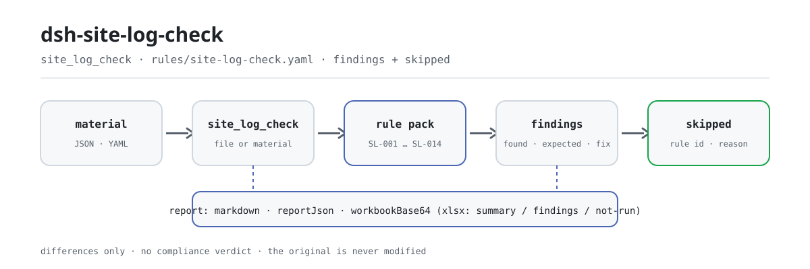

<div align="center">

<picture>
  <source media="(prefers-color-scheme: dark)" srcset="docs/assets/dsh-site-log-check-flow-dark.svg">
  
</picture>

# dsh-site-log-check

**Señala cada día sin registro, cada registro duplicado y cada parte sin supervisión en sitio en la fecha, la columna y la cláusula exactas.**

Un verificador de DeepSeek Harness para ingenieros de supervisión y directores de obra: se le entrega una exportación legible por máquina del archivo de supervisión de una obra y 14 reglas con la cláusula citada devuelven la lista de diferencias literales — sin dictamen de cumplimiento, sin atribución de responsabilidad y sin tocar el original.

[Instalar](#instalación-en-tres-pasos) · [Configuración](#configuración) · [FAQ](#faq) · [简体中文](README.md) · [English](README.en.md) · [Español](README.es.md) · [Português](README.pt.md) · [हिन्दी](README.hi.md)

[](LICENSE)
[](#compatibilidad)
[](https://www.npmjs.com/package/dsh-site-log-check)
[](https://github.com/PerryLink/dsh-site-log-check/actions/workflows/ci.yml)
[](#compatibilidad)

[](https://github.com/PerryLink/dsh-site-log-check/stargazers)
[](https://www.npmjs.com/package/dsh-site-log-check)
[](https://dshfind.com/plugins/PerryLink/dsh-site-log-check?ref=badge)
[](https://securityscorecards.dev/viewer/?uri=github.com/PerryLink/dsh-site-log-check)
[](https://dsh.market/)
[](https://gitee.com/perrylink/dsh-site-log-check)

```sh
dsh plugin --profile <name> add dsh-site-log-check
```

</div>

<sub>Plugin de la comunidad, sin relación con DeepSeek. Repositorio único: <https://github.com/PerryLink/dsh-site-log-check> (Gitee es un espejo).</sub>

## Qué es

`dsh-site-log-check` lee el archivo de supervisión de una obra —el periodo de servicio de supervisión, los registros diarios de supervisión, la lista declarada de partes y procesos clave que requieren supervisión en sitio y los propios registros de supervisión en sitio— y lo contrasta con las cláusulas que cita su paquete de reglas: si un mismo día natural lleva más de un registro o un registro con fecha fuera del periodo de servicio, qué días del periodo no tienen registro, si cada registro rellena sus columnas y nombra a quien lo redactó, si existe la lista declarada y cada parte declarada tiene su registro de supervisión en sitio, si el registro lleva hora de inicio y de fin en orden, la parte y el proceso clave, la empresa constructora, lo que se encontró y las firmas, y si la supervisión en sitio declarada en un registro diario tiene un registro en la misma fecha. Todo lo que informa son diferencias literales, cada una con la cláusula de la que procede, para que las revise una persona.

**Límite:** este plugin comprueba la **continuidad del registro diario de supervisión y la cobertura de los registros de supervisión en sitio** de una obra —el ámbito de la supervisión de obra (工程监理)—. No es `dsh-archive-check` (que comprueba si los registros del proyecto están completos para su archivo), no es `dsh-hazplan-check` (que comprueba las secciones del plan de una parte de obra peligrosa) ni es un inspector de seguridad en obra. Lee una exportación legible por máquina de los registros de la propia oficina de supervisión e informa de desajustes literales frente a las cláusulas citadas.

## Instalación en tres pasos

1. **Instalar** (elija un canal):

   ```sh
   # canal npm (versiones publicadas)
   dsh plugin --profile web add dsh-site-log-check
   # canal git (última main; la instalación ejecuta el paso tsdown de package.json#prepare para producir lib/)
   dsh plugin --profile web add github:PerryLink/dsh-site-log-check
   # canal tarball: tras pnpm pack en este repositorio
   dsh plugin --profile web add ./dsh-site-log-check-<version>.tgz
   ```

   También puede encontrarse como parte de la «Colección de verificación de documentos profesionales» en WorkBuddy / Coze: la colección incluye este verificador y su publicación depende de cada mercado.

2. **Configuración mínima** (los valores por defecto ya sirven):

   ```yaml
   - insert:
       - id: dsh-site-log-check
         name: dsh-site-log-check
   ```

   Todos los parámetros ajustables viven en el esquema Schemastery de `src/config.ts`; los umbrales por regla están en `rules/site-log-check.yaml`.

3. **Comprobar que se ha montado**:

   ```sh
   dsh --profile <name> --dump-config | grep 'dsh-site-log-check'
   ```

   Después, ejecute el ejemplo incluido (alrededor de un minuto; el script importa `lib/index.mjs`, así que compile antes):

   ```sh
   pnpm install && pnpm run build
   node samples/quickstart/run.mjs
   ```

   ```text
   $ node samples/quickstart/run.mjs
   site_log_check: 5 issue(s) — error 0, warn 1, info 4
   skipped: 12
   ```

   La entrada del ejemplo está en `samples/quickstart/input/SL-001-unsafe.yaml` y la salida esperada en `samples/quickstart/expected/result.json`; `node samples/quickstart/run.mjs --json` imprime el mismo resumen en JSON.

**Desinstalar**: `dsh plugin --profile <name> remove dsh-site-log-check` (o elimine la fila del patch del perfil).

<details>
<summary>Instalar desde el mercado de DSH Desktop</summary>

Todos los plugins de PerryLink se pueden explorar en el mercado integrado de DSH Desktop: **Mercado → Fuentes → Añadir fuente → pegar** `https://perrylink-dsh-catalog.perrylink.workers.dev/catalog-source.json` **→ seleccionar**. La instalación sigue requiriendo la verificación de identidad npm del mercado y su confirmación.

</details>

## Capacidades clave

El plugin registra la herramienta `site_log_check`: lee un archivo de supervisión (JSON o YAML), aplica un paquete de reglas versionado y devuelve un informe estructurado; cada hallazgo lleva `found` / `expected` / `fix` y la cláusula de la que procede.

- **El paquete de reglas es dato, no código** — las 14 reglas están en `rules/site-log-check.yaml`; sustituir el archivo cambia el conjunto de reglas sin tocar TypeScript, y el paquete se valida al cargar en lugar de darse por bueno.
- **La gravedad sigue a la prueba** — una regla basada en un principio general (`derived-from-principle`) queda limitada a `warn`; una basada en la configuración de su institución (`institutional-configuration`) queda limitada a `info`; ninguna puede declararse `error` (hay una prueba que lo asegura).
- **Una lista vacía nunca es «todo correcto»** — cada comprobación que no pudo ejecutarse se declara en `skipped` con su id de regla y su motivo, y una regla cuya lista requerida no está configurada se declara en `skipped` en lugar de pasar en silencio.
- **Sin dictamen** — el informe enumera diferencias y nunca se pronuncia sobre cumplimiento, responsabilidad o corrección; un guardián de redacción bloquea los términos que dictaminan y el informe siempre lleva la advertencia.
- **Solo citas literales** — cada regla lleva documento, número, cláusula en la numeración propia de la fuente, extracto literal de al menos ocho caracteres y la URL de la que se leyó; cuando el texto no se pudo obtener el extracto lo dice y la regla se marca `derived-from-principle`; nunca se presenta una paráfrasis como cita.
- **Tres formas de entrega** — cada ejecución devuelve `markdown` (para que lo lea el modelo), `reportJson` (legible por máquina) y `workbookBase64` (un xlsx con tres hojas: resumen, lista de diferencias y comprobaciones no ejecutadas), de modo que el resultado se puede adjuntar al expediente.

```text
material de supervisión (periodo · registros · lista de partes clave · registros en sitio) ──site_log_check──▶ reglas SL-001…SL-014 ──▶ informe (hallazgos + skipped)
        ▲                                                                                                                  │
        └──────────────────────────── la entrada solo se lee, el original nunca se modifica ───────────────────────────────┘
```

### Las reglas de un vistazo

| Regla | Comprueba | Gravedad | Base |
|---|---|---|---|
| `SL-001` | un registro por día natural, dentro del periodo de servicio | warn | GB/T 50319-2013, cláusula 2.0.21 |
| `SL-002` | ningún día natural del periodo de servicio queda sin registro | info | GB/T 50319-2013, cláusula 2.0.21 · DBJT 13-144-2019 7.1.1 |
| `SL-003` | el registro anota el tiempo y las condiciones de la obra | warn | GB/T 50319-2013, cláusula 7.2.2 punto 1 |
| `SL-004` | el registro anota el avance de la obra del día | warn | GB/T 50319-2013, cláusula 7.2.2 punto 2 |
| `SL-005` | el registro anota el trabajo de supervisión del día | warn | GB/T 50319-2013, cláusula 7.2.2 punto 3 |
| `SL-006` | el registro anota los problemas del día **y cómo se trataron** | warn | GB/T 50319-2013, cláusula 7.2.2 punto 4 |
| `SL-007` | el registro nombra a quien lo redactó | warn | GB/T 50319-2013, cláusula 3.2.3 punto 10 |
| `SL-008` | la obra tiene una lista declarada de partes y procesos clave que requieren supervisión en sitio | warn | GB/T 50319-2013, cláusula 5.2.11 · Decreto del Consejo de Estado n.º 279, artículo 38 |
| `SL-009` | el registro en sitio lleva hora de inicio y de fin, en orden | warn | GB/T 50319-2013, tabla A.0.6 |
| `SL-010` | el registro en sitio indica lo encontrado y cómo se trató | warn | GB/T 50319-2013, tabla A.0.6 |
| `SL-011` | el registro en sitio está firmado, y no solo por una parte | warn | GB/T 50319-2013, tabla A.0.6 · 建市〔2002〕189号, artículo 7 |
| `SL-012` | toda parte y proceso clave declarado tiene al menos un registro en sitio | warn | 建市〔2002〕189号, artículos 2 y 9 |
| `SL-013` | la supervisión en sitio declarada en un registro coincide con el libro de registros en sitio | warn | GB/T 50319-2013, cláusula 7.2.2 punto 3 |
| `SL-014` | el registro en sitio nombra la parte o proceso clave y la empresa constructora | warn | GB/T 50319-2013, tabla A.0.6 |

El paquete no tiene ninguna regla de nivel `error`; el motivo está en «Normas que sigue».

### Ejemplos

Estas son las entradas reales del plugin; instálelo una vez y llame a una.

**Salida detallada** — herramienta `site_log_check`, entrada:

```yaml
project:
  serviceStart: "2026-03-01"
  serviceEnd: "2026-03-05"
logs:
  - date: "2026-03-01"
  - date: "2026-03-05"
```

Salida:

```json
{
  "id": "dsh-site-log-check.SL-002.378ce636",
  "ruleId": "SL-002",
  "severity": "info",
  "locator": {
    "cell": "2026-03-02"
  },
  "found": "2026-03-02 无监理日志记录",
  "expected": "监理服务期 2026-03-01 ~ 2026-03-05 内应按日历日记录",
  "fix": "核对是否因停工、节假日或日志未归档；确无施工活动的应有说明"
}
```

*Observed from `dsh-site-log-check/tests/fixtures/SL-002/SL-002-unsafe.yaml`*

**Ejemplo breve**: `site_log_check` · `only: ["SL-001"]` · `rulesFile: rules/site-log-check.yaml` (permite sustituir el paquete de reglas en la llamada para una comparación puntual).

### Qué responde

| Usted pregunta | Qué responde |
|---|---|
| Dos registros diarios llevan la misma fecha natural, ¿se informa de ello? | Sí. `SL-001` aplica `params.maxPerDay` (1) y señala cada día natural con más de un registro; también señala el registro cuya fecha queda fuera del periodo de servicio tomado de `project.serviceStart` y `project.serviceEnd`. Compara fechas y recuentos; no decide cuál de los dos asientos es el del día ni si un asiento añadido después estaba justificado. Si no se puede leer ninguna fecha del material, la regla informa de que no pudo ejecutarse en lugar de pasar en silencio. |
| Faltan tres días de registro en medio del periodo de servicio. ¿Qué hace la comprobación? | `SL-002` cuenta los días naturales entre `project.serviceStart` y `project.serviceEnd` que no tienen registro. Es la única regla `info` del paquete: la exigencia de que las fechas sean consecutivas figura en la norma provincial de Fujian DBJT 13-144-2019, no en GB/T 50319-2013, así que avisa y nunca bloquea. Por debajo de `params.minCoverageRatio` (0.9) enumera cada día que falta como diferencia; en ese valor o por encima informa de que no pudo ejecutarse y nombra allí los días que faltan. Si el hueco fue una parada, un festivo o un registro no archivado lo decide una persona. |
| El registro de un día deja vacía la columna de problemas. | `SL-006` señala ese asiento: todo registro diario debe rellenar la columna de los problemas del día y de cómo se resolvieron. Comprueba que la columna esté rellena, no que el texto sea correcto, así que una anotación que diga que no se encontró nada pasa y una celda vacía no. El paquete deja constancia de que las dos lecturas disponibles de la cláusula 7.2.2 punto 4 difieren en la redacción y de que el escaneo oficial no se pudo releer, por lo que la regla se abstiene a propósito de valorar la redacción y mira solo si la columna está rellena. |
| Nada en el material declara qué partes y procesos clave requieren supervisión en sitio. ¿Pasa en silencio? | No. Cuando el material muestra que hubo supervisión en sitio —existe un registro en sitio, o la columna de trabajo de supervisión de algún registro menciona la supervisión en sitio—, `SL-008` informa de que falta la lista declarada. Cuando nada apunta a que haya supervisión en sitio, la regla informa de que no pudo ejecutarse con ese motivo, en lugar de inventar una exigencia que quizá no corresponda a la obra. El paquete anota que el texto de GB/T 50319-2013 no enumera esas partes y procesos, y que la lista procede del artículo 2 de 建市〔2002〕189号. |
| Nuestro registro en sitio solo está firmado por el ingeniero de supervisión. ¿Se informa? | Sí. Con `params.requireContractorSignature` activado, `SL-011` señala tanto la falta de firma del responsable de supervisión en sitio como la del inspector de calidad en obra de la empresa constructora. El paquete separa a propósito las dos bases: la tabla A.0.6 solo tiene la casilla de firma del responsable de supervisión en sitio, y la segunda firma procede del artículo 7 de 建市〔2002〕189号, así que no debe atribuirse a GB/T 50319-2013. La regla comprueba que las firmas estén consignadas, no que sean auténticas. |
| Un registro dice que el 12 de mayo hubo supervisión en sitio, pero el libro de registros no tiene nada ese día. | `SL-013` lo señala: coteja las fechas de los registros cuya columna de supervisión menciona la supervisión en sitio con las fechas de inicio de los registros en sitio. Solo comprueba que ambas cosas cuadren; el paquete afirma que ni GB/T 50319-2013 ni 建市〔2002〕189号 exigen que los dos documentos se enlacen por número. Si ningún registro en sitio tiene hora de inicio, o ningún registro diario declara supervisión en sitio, la regla informa de que no pudo ejecutarse en lugar de pasar en silencio. |

## Configuración

Todos los parámetros ajustables viven en el esquema Schemastery de `src/config.ts`, por lo que se cambian desde `cordis.yml` sin tocar el código; los umbrales por regla están en el paquete de reglas bajo `rules/`. Las cinco claves siguientes son la lista completa; los parámetros por regla vienen después.

| Clave | Tipo | Predeterminado | Descripción |
|---|---|---|---|
| `rulesFile` | string | `rules/site-log-check.yaml` | Ruta del paquete de reglas, relativa a la raíz del paquete |
| `disabledRules` | string[] | `[]` | Ids de reglas que se dejan de ejecutar; cada una aparece en `skipped` |
| `onlyRules` | string[] | `[]` | Ejecutar solo estas reglas; vacío ejecuta todas |
| `skipNotes` | string | `""` | Nota añadida a cada motivo de `skipped`, p. ej. las normas de aplicación de su institución |
| `timeoutMs` | number | `120000` | Presupuesto cooperativo de tiempo de espera de la herramienta |

Parámetros por regla que conviene conocer:

- `SL-001` `maxPerDay` — cuántos registros admite un mismo día natural; por defecto `1`.
- `SL-002` `minCoverageRatio` (por defecto `0.9`) e `ignoreWeekends` (por defecto `false`) — cuando la cobertura alcanza el ratio, la regla informa por `skipped` y enumera allí los días que faltan en vez de una diferencia por día.
- `SL-009` `requireEndTime` (por defecto `true`) — póngalo en `false` para dejar de exigir la hora de fin.
- `SL-011` `requireContractorSignature` (por defecto `true`) — póngalo en `false` si su contrato no aplica la firma de las dos partes.
- `SL-012` `keyWorks` — el catálogo de partes y procesos clave, por defecto literal del artículo 2 de 建市〔2002〕189号; ese artículo solo cubre la **edificación de vivienda**, y otras disciplinas se remiten a él por el artículo 12 de la misma norma, así que sustituya la lista.

Ejemplo de sustitución en el patch del perfil:

```yaml
- insert:
    - id: dsh-site-log-check
      name: dsh-site-log-check
      config:
        onlyRules: [SL-001, SL-002]
        skipNotes: normas de aplicación de esta institución, edición 2026
```

## FAQ

<details>
<summary>¿Se modifica o se sube a algún sitio mi material?</summary>

No. La herramienta solo lee el JSON/YAML que usted le entrega (`file` o `material`) y **nunca modifica el original**; el plugin es ESM puro, sin código nativo, **sin red y sin llamada al modelo** (véase «Compatibilidad»), y `package.json#dsh.demo` declara `network: false` con `writes: []`. El xlsx del informe es un campo `workbookBase64`: usted decide si lo guarda, y el plugin no escribe nada en disco.

</details>

<details>
<summary>¿Se puede leer una lista de diferencias vacía como «no hay nada malo»?</summary>

No. Una lista vacía solo significa que las reglas que **sí se ejecutaron** no hallaron diferencias; una regla que no pudo ejecutarse declara su id y su motivo en `skipped`. El ejemplo incluido lo demuestra: dos registros, sin lista de partes clave y sin registros en sitio producen 1 hallazgo `warn` y 4 `info`, además de 12 comprobaciones omitidas. El informe siempre lleva la advertencia de que no constituye un dictamen sobre ningún hecho, acto o documento.

</details>

<details>
<summary>¿Compite con otros plugins por nombres de herramienta, comandos o rutas?</summary>

No. Registra una única herramienta con espacio de nombres propio, `site_log_check`, y su `inject` solo declara `tools`; no aporta ninguna clave de servicio, no registra slot de cliente ni ruta `webServer`, y su patch de bundle solo hace `insert` de su propia fila sin sobrescribir el `config` de una fila integrada. El registro es un efecto de Cordis, así que descargar o recargar en caliente lo retira.

</details>

<details>
<summary>¿Aguanta un lote de obras?</summary>

Sí. El núcleo de comprobación es una función pura: lectura de un archivo y comparaciones de cadenas con 14 reglas, sin peticiones de red ni llamadas al modelo; `timeoutMs` es el presupuesto cooperativo (120000 ms por defecto). La herramienta funciona en modo `native` y en `ptc`; para un directorio completo conviene `ptc`, así el coste del esquema se paga una vez.

</details>

<details>
<summary>Nuestra norma local o nuestro reglamento interno es más estricto, ¿se puede incorporar?</summary>

Sí, y sin tocar código: apunte `rulesFile` a su propio YAML. El tipo de base fija el tope de gravedad —el razonamiento por principio general (`derived-from-principle`) en `warn`, los umbrales institucionales (`institutional-configuration`) en `info`—, de modo que el paquete nunca produce `error`, y el extracto debe seguir siendo una cita literal de al menos ocho caracteres.

</details>

## Normas que sigue

| Documento | Número | Reglas que lo citan |
|---|---|---|
| 《建设工程监理规范》 (código de práctica de la supervisión de obras) | GB/T 50319-2013 | SL-001, SL-002, SL-003, SL-004, SL-005, SL-006, SL-007, SL-008, SL-009, SL-010, SL-011, SL-013, SL-014 |
| 福建省《建设工程监理文件资料管理标准》 (norma provincial de Fujian sobre documentos de supervisión) | DBJT 13-144-2019 | SL-002 |
| 《建设工程质量管理条例》 (reglamento de calidad de las obras) | 国务院令第279号 (Decreto del Consejo de Estado n.º 279) | SL-008 |
| 《房屋建筑工程施工旁站监理管理办法（试行）》 (norma de supervisión en sitio de partes clave, en vigor) | 建市〔2002〕189号 | SL-011, SL-012 |

> ### ⚠️ Aquí nada es `error`, porque la norma es *recomendada*
>
> **GB/T 50319-2013 es una norma nacional recomendada** — el Aviso n.º 35 del Ministerio de
> Vivienda y Desarrollo Urbano-Rural la aprueba como «norma nacional, **numerada GB/T
> 50319-2013**», y su prefacio **no declara obligatorio ningún capítulo**. Compare con
> **GB 26860—2011**, cuyo prefacio dice expresamente que «el capítulo 5 y el 7.3.4 son
> recomendatorios y **el resto obligatorio**». El «debe» de estas cláusulas es convención de
> redacción de normas de ingeniería, **no obligación legal**, por lo que toda regla queda limitada
> a `warn` y **este plugin no bloquea nada**.
>
> Eso no significa que los requisitos no importen: **el registro diario de supervisión y la
> supervisión en sitio son deberes legales según el reglamento de calidad de las obras**. Pero la
> norma que contiene las *cláusulas concretas que aquí se comprueban* es recomendatoria, así que el
> plugin avisa en lugar de bloquear.

## Formato del material

La herramienta acepta JSON o YAML. En la capa de lectura los campos son opcionales y los valida el motor de comprobación, de modo que una exportación parcial produce hallazgos sobre lo que falta en lugar de un fallo.

```yaml
target: 某住宅楼工程 监理日志与旁站记录
project:
  name: 某住宅楼工程
  serviceStart: "2026-03-01"
  serviceEnd: "2026-03-05"
logs:
  - date: "2026-03-01"
    weather: 晴，具备施工条件
    progress: 三层顶板钢筋绑扎完成 80%
    supervision: 巡视 2 次；旁站混凝土浇筑 1 次
    issues: 个别箍筋间距偏大，已要求班组整改并复查
    recorder: 张监理
keyWorks:
  - name: 土方回填
    contractor: 某基础工程公司
onsite:
  - id: PZ-0001
    keyWork: 混凝土浇筑
    contractor: 某建筑公司
    startedAt: "2026-03-04 08:00"
    endedAt: "2026-03-04 12:30"
    issues: 未发现问题；坍落度经检测符合要求
    supervisorSignature: 张监理
    contractorSignature: 李质检
```

- `project.serviceStart` / `project.serviceEnd` fijan el periodo de servicio que miden `SL-001`, `SL-002` y `SL-013`.
- `logs[]` lleva `weather` / `progress` / `supervision` / `issues` / `recorder`, que comprueban `SL-003` a `SL-007`.
- `keyWorks[]` es la lista declarada: `SL-008` comprueba que exista y `SL-012` que cada elemento tenga un registro en sitio.
- `onsite[]` lleva `startedAt` / `endedAt` para `SL-009`, `issues` para `SL-010`, ambas firmas para `SL-011` y `keyWork` / `contractor` para `SL-014`.

## Fuentes de las reglas

Los datos de las reglas están en `rules/site-log-check.yaml`, separados del código. Cada regla lleva documento, número, cláusula en la numeración propia de la fuente, extracto literal y la URL de la que se leyó. El cargador impone que el extracto sea una cita real de al menos ocho caracteres y que una comprobación basada solo en un principio general (`kind: derived-from-principle`, tope `warn`) o en la configuración de la institución (`kind: institutional-configuration`, tope `info`) **nunca** pueda declararse `error`. Un paquete que exagere su base falla al cargar en lugar de producir un informe de aspecto seguro.

Los números de cláusula se contrastaron con el texto completo de GB/T 50319-2013 y de 建市〔2002〕189号. Tres hallazgos dieron forma al paquete y se registran aquí para que quien revise vea lo que **deliberadamente no** se afirmó:

1. **La «continuidad diaria» no tiene cláusula nacional.** GB/T 50319-2013 solo dice «diario» en su definición del registro de supervisión (cláusula 2.0.21). Las palabras «las fechas deben ser consecutivas» proceden de la norma provincial de Fujian DBJT 13-144-2019, una norma *local*, y por eso `SL-002` queda limitada a `info`.
2. **La firma de las dos partes no es un requisito de la 50319.** La tabla A.0.6 tiene una sola casilla de firma, la del responsable de supervisión en sitio. La exigencia de que también firme el inspector de calidad de la empresa constructora procede del artículo 7 de 建市〔2002〕189号, y `SL-011` cita ambos documentos por separado en lugar de fusionarlos.
3. **La firma diaria y el visto bueno del director son requisitos locales.** Proceden de la norma de Shandong DB37/T 5009, no de la norma nacional, así que el paquete solo comprueba que se nombre a quien redactó (`SL-007`) y no inventa una obligación de firma.

El catálogo de partes clave de `SL-012` también se cotejó carácter a carácter con el artículo 2 de 建市〔2002〕189号. El registro completo de verificación de cláusulas, incluidas las fuentes comprobadas y descartadas, está en `rules/evidence/`.

## Limitaciones conocidas

- **Solo partidas literales y decidibles por máquina.** No decide si un asiento tardío estaba justificado, si un hueco fue una parada, un festivo o un registro sin archivar, si una firma es auténtica o si el texto de una columna es correcto: eso queda para una persona.
- **Ninguna regla de nivel `error`.** La norma que contiene las cláusulas concretas aquí comprobadas, GB/T 50319-2013, es una norma nacional recomendada, así que las 14 reglas se quedan en `warn` o `info`; el deber está en el artículo 38 del reglamento de calidad de las obras y la práctica en una norma recomendatoria.
- **El umbral de continuidad es una configuración institucional.** `SL-002` y su `minCoverageRatio` (por defecto `0.9`) solo trasladan los días que faltan a `skipped` cuando la cobertura alcanza el ratio, en lugar de enumerar cada día; `ignoreWeekends` vale `false` por defecto, así que los fines de semana también cuentan.
- **El catálogo de `SL-012` solo cubre la edificación de vivienda.** Es literal del artículo 2 de 建市〔2002〕189号; otras disciplinas se remiten a esa norma por su artículo 12 y deben sustituir `keyWorks`.
- **Conviven dos lecturas de la cláusula 7.2.2 punto 4.** Las dos fuentes disponibles la redactan de forma distinta y el escaneo oficial no se pudo releer en esta ronda, así que `SL-006` solo comprueba que la columna esté rellena y no se pronuncia sobre la redacción: es un límite de la comprobación, no una afirmación de que una lectura sea errónea.
- **La firma diaria y el visto bueno del director no están en la norma nacional.** Proceden de la norma de Shandong DB37/T 5009; el plugin solo comprueba que se nombre a un responsable de redacción y no inventa una obligación de firma.
- **Las fechas son aritmética de cadena en hora local.** Todos los cálculos se hacen sobre las cadenas de entrada en hora local, sin conversión de husos horarios.

## Compatibilidad

| Superficie | Estado |
|---|---|
| Harness | Rango de peers `>=0.1.2-rc.1 <0.2.0 \|\| >=0.2.0-0 <0.3.0` — verificado para aceptar tanto `0.2.0-rc.2` como `0.2.1-rc.2`. `engines.dsh` se declara como `>=0.2.1-0 <0.3.0` y el host lo aplica desde 0.2.1 |
| Node | `^22.19.0 \|\| >=24.0.0` |
| Plataformas | Todas (ESM puro; sin código nativo, sin red, sin llamada al modelo) |
| Modo de herramienta | Funciona en `native` y `ptc`; para un lote de verificaciones use `ptc`, así el coste del esquema se paga una vez |

## Solución de problemas

- **El plugin se instala pero la herramienta no aparece.** Compruebe que `main` resuelve a `lib/index.mjs` y que `pnpm run build` lo generó; un `main` incorrecto hace que el cargador omita la entrada en silencio.
- **`dsh plugin add` rechaza el paquete por incompatibilidad.** El rango de peers cubre `0.1.x` y `0.2.x`; si su entorno queda fuera, conceda una exención explícita: `dsh plugin --profile <name> allow-version dsh-site-log-check@0.1.0 --dsh-version <runtime> --accept-risk`.
- **`SL-002` no informa de nada.** La cobertura sigue por encima de `minCoverageRatio`, así que los días que faltan se nombran en el `skipped` de esa regla; baje el ratio si quiere cada hueco como diferencia.
- **Una regla no se ejecutó.** Lea la lista de «comprobaciones no ejecutadas» al final del informe: indica el id de la regla y el motivo (desactivada, lista no configurada, entrada no utilizable).
- **`check` informa `manifest-peers` como fallo.** El verificador estático compara con un rango de peers fijo anterior a la línea 0.2; el entorno aplica la compatibilidad al instalar, así que el rango declarado es el correcto. Es un problema conocido de `dsh-plugin-dev`.
- **Un hallazgo dice que no se obtuvo el texto de la cláusula.** El paquete nunca inventa texto de cláusulas: si el texto literal no está disponible, la regla se queda en `warn` / `info` y lo dice en su `excerpt`. Trátelo como una laguna de verificación, no como prueba de que el documento esté bien.
- **Los horarios parecen desplazados.** Todos los cálculos son de hora local sobre las cadenas de entrada, sin conversión de husos horarios.

## Ecosistema y calidad

- [Espejo en Gitee](https://gitee.com/perrylink/dsh-site-log-check) (espejo sincronizado; GitHub es la referencia)
- [Página del plugin en dshfind](https://dshfind.com/plugins/PerryLink/dsh-site-log-check) (instalaciones y clasificación)
- [Informe OpenSSF Scorecard](https://securityscorecards.dev/viewer/?uri=github.com/PerryLink/dsh-site-log-check) (impulsado por [.github/workflows/scorecard.yml](.github/workflows/scorecard.yml))
- [DSH Market](https://dsh.market/) (publicado)
- [Base de conocimiento del ecosistema — elegir un verificador por material](https://perrylink.github.io/zh/checkers/choose/) (índice completo de la familia: 62 verificadores + plugins generales)

## Desarrollo

```sh
pnpm install
pnpm run typecheck        # tsc --noEmit
pnpm test                 # vitest, fixtures emparejados por regla (tests/fixtures/<RULE>/)
pnpm run build            # tsdown -> lib/index.mjs + lib/index.d.mts
pnpm run verify:self-contained   # las dependencias resuelven desde el registro
pnpm run check:lockfile   # pnpm-lock sin deriva
pnpm run check:readmes    # coherencia de los README en cinco idiomas
pnpm run check:citations  # cada excerpt (también alsoBasis) es cita literal
pnpm pack                 # el tarball publicado
node ../scripts/sync-shared.mjs dsh-site-log-check   # refrescar src/shared desde ../_shared
```

Estructura:

| Ruta | Función |
|---|---|
| `src/index.ts` | contrato de plugin de función (`name` / `inject` / `Config` / `apply`); registra la herramienta `site_log_check` |
| `src/config.ts` | esquema Schemastery; aquí viven todos los parámetros, sin umbrales codificados |
| `src/check.ts` | núcleo puro de comprobación `(input, ruleset, options) => Report`: sin contexto de plugin, sin E/S, sin reloj |
| `src/parse.ts` | lector del material canónico (JSON o YAML) |
| `src/view.ts` | proyección del informe para el modelo; `output.schema` la refleja |
| `src/shared/` | kit compartido (carga del paquete de reglas, forma del informe, subconjunto YAML, aritmética de calendario, guardián de redacción); copiado para que el paquete sea autocontenido |
| `rules/site-log-check.yaml` | el paquete de reglas, 14 reglas |
| `rules/evidence/` | registro de verificación de cláusulas de cada cita |
| `tests/` | vitest; cada regla tiene su par de fixtures conforme/infractor en `tests/fixtures/<RULE>/` |
| `samples/quickstart/` | ejemplo rápido reejecutable (entrada y salida esperada) |

El paquete de reglas es dato, no código: edite `rules/*.yaml` para cambiar el conjunto de reglas sin tocar TypeScript; el paquete se valida al cargar, no se da por bueno. Las imágenes del README las genera de forma programática [`scripts/gen-readme-assets.py`](scripts/gen-readme-assets.py) (Python + Pillow) y se pueden volver a ejecutar sin riesgo; este plugin no tiene interfaz, así que el hero es un diagrama de flujo SVG dibujado a mano (par claro + oscuro, solo tokens de la superficie de comandos).

Topics: `dsh`, `dsh-plugin`, `deepseek-harness`, `deepseek`, `cordis`, `site`, `log`

## Familia y agradecimientos

Este proyecto forma parte de la familia de plugins de DeepSeek Harness mantenida por [PerryLink](https://github.com/PerryLink) (todos Apache-2.0). Si este plugin le resulta útil, **una estrella** no desbloquea nada pero facilita que lo encuentre la siguiente persona.

- [@PerryLink](https://github.com/PerryLink) — creador y mantenedor: la herramienta `site_log_check`, el paquete de reglas con citas literales y su registro de verificación de cláusulas (`rules/evidence/`), y la documentación en cinco idiomas.

<details>
<summary>Expandir todos los plugins</summary>

| Plugin | Estado |
|---|---|
| **[dsh-aqua-input-check](https://github.com/PerryLink/dsh-aqua-input-check)** |  |
| **[dsh-archive-check](https://github.com/PerryLink/dsh-archive-check)** |  |
| **[dsh-auto-review](https://github.com/PerryLink/dsh-auto-review)** |  |
| **[dsh-autotier](https://github.com/PerryLink/dsh-autotier)** | 🧊 CONGELADO — ver el README del repo |
| **[dsh-bid-ca-precheck](https://github.com/PerryLink/dsh-bid-ca-precheck)** |  |
| **[dsh-bid-qual-check](https://github.com/PerryLink/dsh-bid-qual-check)** |  |
| **[dsh-cert-mcp](https://github.com/PerryLink/dsh-cert-mcp)** | 🧊 CONGELADO — ver el README del repo |
| **[dsh-checkpoint-rewind](https://github.com/PerryLink/dsh-checkpoint-rewind)** |  |
| **[dsh-click](https://github.com/PerryLink/dsh-click)** |  |
| **[dsh-composer-history](https://github.com/PerryLink/dsh-composer-history)** |  |
| **[dsh-contract-stance](https://github.com/PerryLink/dsh-contract-stance)** |  |
| **[dsh-customs-doc-check](https://github.com/PerryLink/dsh-customs-doc-check)** |  |
| **[dsh-data-quality](https://github.com/PerryLink/dsh-data-quality)** | 🧊 CONGELADO — ver el README del repo |
| **[dsh-demurrage-ledger](https://github.com/PerryLink/dsh-demurrage-ledger)** |  |
| **[dsh-doublecheck](https://github.com/PerryLink/dsh-doublecheck)** |  |
| **[dsh-drill-script-check](https://github.com/PerryLink/dsh-drill-script-check)** |  |
| **[dsh-eia-guide-check](https://github.com/PerryLink/dsh-eia-guide-check)** |  |
| **[dsh-emergency-plan](https://github.com/PerryLink/dsh-emergency-plan)** |  |
| **[dsh-essay-rubric-check](https://github.com/PerryLink/dsh-essay-rubric-check)** |  |
| **[dsh-evidence-check](https://github.com/PerryLink/dsh-evidence-check)** |  |
| **[dsh-export-ctl-check](https://github.com/PerryLink/dsh-export-ctl-check)** |  |
| **[dsh-fast](https://github.com/PerryLink/dsh-fast)** |  |
| **[dsh-fmea-table-check](https://github.com/PerryLink/dsh-fmea-table-check)** |  |
| **[dsh-forecast-penalty](https://github.com/PerryLink/dsh-forecast-penalty)** |  |
| **[dsh-fund-research](https://github.com/PerryLink/dsh-fund-research)** |  |
| **[dsh-github](https://github.com/PerryLink/dsh-github)** |  |
| **[dsh-gongwen-flow-check](https://github.com/PerryLink/dsh-gongwen-flow-check)** |  |
| **[dsh-gongwen-word-check](https://github.com/PerryLink/dsh-gongwen-word-check)** |  |
| **[dsh-guard-plan-qc](https://github.com/PerryLink/dsh-guard-plan-qc)** |  |
| **[dsh-hazchem-check](https://github.com/PerryLink/dsh-hazchem-check)** |  |
| **[dsh-hazplan-check](https://github.com/PerryLink/dsh-hazplan-check)** |  |
| **[dsh-hidden-risk-map](https://github.com/PerryLink/dsh-hidden-risk-map)** |  |
| **[dsh-hs-classify](https://github.com/PerryLink/dsh-hs-classify)** |  |
| **[dsh-icd-rule-check](https://github.com/PerryLink/dsh-icd-rule-check)** |  |
| **[dsh-industry-research](https://github.com/PerryLink/dsh-industry-research)** |  |
| **[dsh-lawcite-adapter](https://github.com/PerryLink/dsh-lawcite-adapter)** |  |
| **[dsh-laya](https://github.com/PerryLink/dsh-laya)** |  |
| **[dsh-lc-doc-check](https://github.com/PerryLink/dsh-lc-doc-check)** |  |
| **[dsh-learning-gap-check](https://github.com/PerryLink/dsh-learning-gap-check)** |  |
| **[dsh-library](https://github.com/PerryLink/dsh-library)** |  |
| **[dsh-local-ai](https://github.com/PerryLink/dsh-local-ai)** |  |
| **[dsh-lsp-actions](https://github.com/PerryLink/dsh-lsp-actions)** |  |
| **[dsh-mask](https://github.com/PerryLink/dsh-mask)** |  |
| **[dsh-mcp-panel](https://github.com/PerryLink/dsh-mcp-panel)** |  |
| **[dsh-medrec-qc](https://github.com/PerryLink/dsh-medrec-qc)** |  |
| **[dsh-memento](https://github.com/PerryLink/dsh-memento)** | 🧊 CONGELADO — ver el README del repo |
| **[dsh-nsfc-form-check](https://github.com/PerryLink/dsh-nsfc-form-check)** |  |
| **[dsh-nurse-record-check](https://github.com/PerryLink/dsh-nurse-record-check)** |  |
| **[dsh-observe](https://github.com/PerryLink/dsh-observe)** |  |
| **[dsh-origin-rvc-check](https://github.com/PerryLink/dsh-origin-rvc-check)** |  |
| **[dsh-ota-review-check](https://github.com/PerryLink/dsh-ota-review-check)** |  |
| **[dsh-output-styles](https://github.com/PerryLink/dsh-output-styles)** |  |
| **[dsh-paper-doc-adapter](https://github.com/PerryLink/dsh-paper-doc-adapter)** |  |
| **[dsh-permission-rules](https://github.com/PerryLink/dsh-permission-rules)** |  |
| **[dsh-permit-report-check](https://github.com/PerryLink/dsh-permit-report-check)** |  |
| **[dsh-pipeline-check](https://github.com/PerryLink/dsh-pipeline-check)** |  |
| **[dsh-pleading-draft](https://github.com/PerryLink/dsh-pleading-draft)** |  |
| **[dsh-plugin-doctor](https://github.com/PerryLink/dsh-plugin-doctor)** | 🚫 RETIRADO (repo archivado) |
| **[dsh-plugin-guide](https://github.com/PerryLink/dsh-plugin-guide)** |  |
| **[dsh-plugin-kit](https://github.com/PerryLink/dsh-plugin-kit)** | 🚫 RETIRADO (repo archivado) |
| **[dsh-plugin-upgrade](https://github.com/PerryLink/dsh-plugin-upgrade)** | 🚫 RETIRADO (repo archivado) |
| **[dsh-policy-brief-draft](https://github.com/PerryLink/dsh-policy-brief-draft)** |  |
| **[dsh-power-loss-split](https://github.com/PerryLink/dsh-power-loss-split)** |  |
| **[dsh-power-ticket-check](https://github.com/PerryLink/dsh-power-ticket-check)** |  |
| **[dsh-ppap-check](https://github.com/PerryLink/dsh-ppap-check)** |  |
| **[dsh-protest-deadline](https://github.com/PerryLink/dsh-protest-deadline)** |  |
| **[dsh-railway-window](https://github.com/PerryLink/dsh-railway-window)** |  |
| **[dsh-repair-order-qc](https://github.com/PerryLink/dsh-repair-order-qc)** |  |
| **[dsh-research-report](https://github.com/PerryLink/dsh-research-report)** |  |
| **[dsh-review-reply-check](https://github.com/PerryLink/dsh-review-reply-check)** |  |
| **[dsh-rulefile-check](https://github.com/PerryLink/dsh-rulefile-check)** |  |
| **[dsh-safety-brief-check](https://github.com/PerryLink/dsh-safety-brief-check)** |  |
| **[dsh-score](https://github.com/PerryLink/dsh-score)** | 🧊 CONGELADO — ver el README del repo |
| **[dsh-session-sync](https://github.com/PerryLink/dsh-session-sync)** |  |
| **[dsh-site-log-check](https://github.com/PerryLink/dsh-site-log-check)** |  |
| **[dsh-skill-pack-security](https://github.com/PerryLink/dsh-skill-pack-security)** |  |
| **[dsh-soe-decision-check](https://github.com/PerryLink/dsh-soe-decision-check)** |  |
| **[dsh-soilwater-check](https://github.com/PerryLink/dsh-soilwater-check)** |  |
| **[dsh-sop-sync-check](https://github.com/PerryLink/dsh-sop-sync-check)** |  |
| **[dsh-spc-gbt-adapter](https://github.com/PerryLink/dsh-spc-gbt-adapter)** |  |
| **[dsh-talk](https://github.com/PerryLink/dsh-talk)** |  |
| **[dsh-tender-extract](https://github.com/PerryLink/dsh-tender-extract)** |  |
| **[dsh-tender-matrix](https://github.com/PerryLink/dsh-tender-matrix)** |  |
| **[dsh-test-drive](https://github.com/PerryLink/dsh-test-drive)** |  |
| **[dsh-ticktick](https://github.com/PerryLink/dsh-ticktick)** | 🚫 RETIRADO (repo archivado) |
| **[dsh-translate](https://github.com/PerryLink/dsh-translate)** |  |
| **[dsh-warranty-calc](https://github.com/PerryLink/dsh-warranty-calc)** |  |
| **[dsh-budget](https://github.com/PerryLink/dsh-budget)** | 🧊 CONGELADO — ver el README del repo |
| **[dsh-claude-move](https://github.com/PerryLink/dsh-claude-move)** | 🧊 CONGELADO — ver el README del repo |
| **[dsh-defend](https://github.com/PerryLink/dsh-defend)** | 🧊 CONGELADO — ver el README del repo |
| **[dsh-draw](https://github.com/PerryLink/dsh-draw)** | 🧊 CONGELADO — ver el README del repo |
| **[dsh-reach](https://github.com/PerryLink/dsh-reach)** | 🧊 CONGELADO — ver el README del repo |
| **[dsh-background-agents](https://github.com/PerryLink/dsh-background-agents)** | 🚫 RETIRADO (repo archivado) |
| **[dsh-session-pin](https://github.com/PerryLink/dsh-session-pin)** | 🚫 RETIRADO (repo archivado) |
| **[dsh-team-rooms](https://github.com/PerryLink/dsh-team-rooms)** | 🚫 RETIRADO (repo archivado) |

</details>

## Licencia

[LICENSE](LICENSE) (Apache License 2.0) © 2026 dsh-site-log-check contributors

<p align="center"><sub>Apache-2.0 · plugin de la comunidad, sin relación con DeepSeek.</sub></p>
