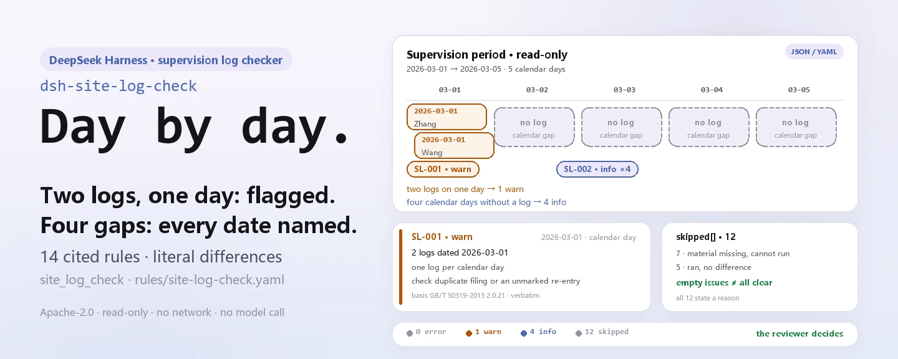

<div align="center">

<picture>
  <source media="(prefers-color-scheme: dark)" srcset="docs/assets/dsh-site-log-check-hero-en-dark.webp">
  
</picture>

# dsh-site-log-check

**बिना लॉग वाला हर दिन, हर दोहरा लॉग और हर बिना स्थल-पर्यवेक्षण रिकॉर्ड वाला मुख्य भाग — ठीक उसी तारीख, कॉलम और उद्धृत धारा तक पहुँचाइए।**

पर्यवेक्षण अभियंताओं और प्रमुख प्रतिनिधियों के लिए DeepSeek Harness जाँच प्लगइन: एक परियोजना के पर्यवेक्षण अभिलेख का मशीन-पठनीय निर्यात दीजिए, और धारा-स्तरीय उद्धरण वाले 14 नियम शाब्दिक अंतरों की सूची लौटाते हैं — कोई अनुपालन निर्णय नहीं, कोई दायित्व-निर्धारण नहीं, मूल में कोई बदलाव नहीं।

[इंस्टॉल](#तीन-चरणों-में-शुरुआत) · [कॉन्फ़िगरेशन](#कॉन्फ़िगरेशन) · [FAQ](#faq) · [简体中文](README.md) · [English](README.en.md) · [Español](README.es.md) · [Português](README.pt.md) · [हिन्दी](README.hi.md)

[](LICENSE)
[](#संगतता)
[](https://www.npmjs.com/package/dsh-site-log-check)
[](https://github.com/PerryLink/dsh-site-log-check/actions/workflows/ci.yml)
[](#संगतता)

[](https://github.com/PerryLink/dsh-site-log-check/stargazers)
[](https://www.npmjs.com/package/dsh-site-log-check)
[](https://dshfind.com/plugins/PerryLink/dsh-site-log-check?ref=badge)
[](https://securityscorecards.dev/viewer/?uri=github.com/PerryLink/dsh-site-log-check)
[](https://dsh.market/)
[](https://gitee.com/perrylink/dsh-site-log-check)

```sh
dsh plugin --profile <name> add dsh-site-log-check
```

</div>

<sub>समुदाय प्लगइन, DeepSeek से संबद्ध नहीं। एकमात्र रेपो: <https://github.com/PerryLink/dsh-site-log-check> (Gitee एक मिरर है)।</sub>

## यह क्या है

`dsh-site-log-check` किसी निर्माण परियोजना का पर्यवेक्षण अभिलेख पढ़ता है — पर्यवेक्षण सेवा अवधि, दैनिक पर्यवेक्षण लॉग, स्थल-पर्यवेक्षण आवश्यक बताए गए मुख्य भागों और प्रक्रियाओं की घोषित सूची, और स्थल-पर्यवेक्षण रिकॉर्ड — और उसे अपने नियम-पैक में उद्धृत धाराओं से मिलाता है: क्या एक ही कैलेंडर दिन पर एक से अधिक लॉग हैं या कोई लॉग सेवा अवधि के बाहर की तारीख का है, अवधि के कौन-से दिन बिना लॉग हैं, क्या प्रत्येक लॉग अपने कॉलम भरता है और लेखक का नाम देता है, घोषित सूची मौजूद है और हर घोषित मद का स्थल-पर्यवेक्षण रिकॉर्ड है, स्थल-पर्यवेक्षण रिकॉर्ड में आरंभ और समाप्ति समय क्रम में, मुख्य भाग या प्रक्रिया, निर्माण इकाई, जो पाया गया और हस्ताक्षर दर्ज हैं, और लॉग में बताया गया स्थल-पर्यवेक्षण उसी तारीख के रिकॉर्ड से मेल खाता है। जो दर्ज होता है वह शब्दशः अंतर है और हर अंतर के साथ उसकी धारा आती है; समीक्षा मनुष्य करता है।

**सीमा:** यह प्लगइन एक निर्माण परियोजना के **दैनिक पर्यवेक्षण लॉग की निरंतरता और स्थल-पर्यवेक्षण रिकॉर्ड की व्याप्ति** की जाँच करता है — अर्थात्工程监理 का क्षेत्र। यह `dsh-archive-check` नहीं है (वह जाँचता है कि परियोजना अभिलेख संग्रहण के लिए पूरे हैं या नहीं), `dsh-hazplan-check` नहीं है (वह किसी संकटग्रस्त उप-परियोजना की योजना के अनुभाग जाँचता है), और न ही स्थल-सुरक्षा निरीक्षक है। यह पर्यवेक्षण कार्यालय के अपने अभिलेखों का मशीन-पठनीय निर्यात पढ़ता है और उद्धृत धाराओं के सामने शाब्दिक असंगतियाँ दर्ज करता है।

<picture>
  <source media="(prefers-color-scheme: dark)" srcset="docs/assets/dsh-site-log-check-flow-v5-dark.svg">
  
</picture>

## तीन चरणों में शुरुआत

1. **इंस्टॉल** (एक चैनल चुनें):

   ```sh
   # npm चैनल (प्रकाशित संस्करण)
   dsh plugin --profile web add dsh-site-log-check
   # git चैनल (नवीनतम main; इंस्टॉल के समय package.json#prepare का tsdown चलकर lib/ बनता है)
   dsh plugin --profile web add github:PerryLink/dsh-site-log-check
   # tarball चैनल: इस रेपो में pnpm pack के बाद
   dsh plugin --profile web add ./dsh-site-log-check-<version>.tgz
   ```

   इसे WorkBuddy / Coze पर «व्यावसायिक दस्तावेज़ जाँच संग्रह» के हिस्से के रूप में भी खोजा जा सकता है — संग्रह में यह जाँच शामिल है, और सूचीकरण प्रत्येक मार्केट पर निर्भर है।

2. **न्यूनतम कॉन्फ़िगरेशन** (डिफ़ॉल्ट चलते हैं):

   ```yaml
   - insert:
       - id: dsh-site-log-check
         name: dsh-site-log-check
   ```

   सभी समायोज्य पैरामीटर `src/config.ts` की Schemastery स्कीमा में हैं; प्रति-नियम सीमाएँ `rules/site-log-check.yaml` में हैं।

3. **जाँचें कि माउंट हो गया**:

   ```sh
   dsh --profile <name> --dump-config | grep 'dsh-site-log-check'
   ```

   फिर साथ आए उदाहरण को चलाएँ (लगभग एक मिनट; स्क्रिप्ट `lib/index.mjs` से आयात करती है, इसलिए पहले बिल्ड करें):

   ```sh
   pnpm install && pnpm run build
   node samples/quickstart/run.mjs
   ```

   ```text
   $ node samples/quickstart/run.mjs
   site_log_check: 5 issue(s) — error 0, warn 1, info 4
   skipped: 12
   ```

   उदाहरण इनपुट `samples/quickstart/input/SL-001-unsafe.yaml` में और अपेक्षित आउटपुट `samples/quickstart/expected/result.json` में है; `node samples/quickstart/run.mjs --json` वही सारांश JSON में देता है।

**अनइंस्टॉल**: `dsh plugin --profile <name> remove dsh-site-log-check` (या प्रोफ़ाइल पैच से वह पंक्ति हटा दें)।

<details>
<summary>DSH Desktop मार्केट से इंस्टॉल करें</summary>

सभी PerryLink प्लगइन DSH Desktop के अंतर्निहित मार्केट में देखे जा सकते हैं: **मार्केट → स्रोत → स्रोत जोड़ें → चिपकाएँ** `https://perrylink-dsh-catalog.perrylink.workers.dev/catalog-source.json` **→ चुनें**। इंस्टॉल के लिए मार्केट की npm पहचान जाँच और आपकी पुष्टि अब भी आवश्यक है।

</details>

## मुख्य क्षमताएँ

प्लगइन `site_log_check` टूल पंजीकृत करता है: एक पर्यवेक्षण अभिलेख (JSON या YAML) पढ़ता है, संस्करण-बद्ध नियम-पैक लागू करता है और एक संरचित रिपोर्ट लौटाता है; हर निष्कर्ष के साथ `found` / `expected` / `fix` और उसकी उद्धृत धारा आती है।

- **नियम-पैक डेटा है, कोड नहीं** — सभी 14 नियम `rules/site-log-check.yaml` में हैं; फ़ाइल बदलने से TypeScript छुए बिना नियम-समुच्चय बदल जाता है, और पैक लोड के समय सत्यापित होता है, मान लिया नहीं जाता।
- **गंभीरता आधार के अनुसार** — सामान्य सिद्धांत पर टिका नियम (`derived-from-principle`) `warn` तक सीमित रहता है; आपकी संस्था की कॉन्फ़िगरेशन पर टिका नियम (`institutional-configuration`) `info` तक; किसी को भी कभी `error` घोषित नहीं किया जा सकता (एक टेस्ट इसकी पुष्टि करता है)।
- **खाली सूची कभी «सब ठीक» नहीं होती** — जो जाँच नहीं चल पाई वह `skipped` में अपना नियम id और कारण बताती है, और जिस नियम की आवश्यक सूची सेट नहीं है वह चुपचाप पास होने के बजाय `skipped` में स्वयं को दर्ज करता है।
- **कोई निर्णय नहीं** — रिपोर्ट केवल अंतर गिनाती है और अनुपालन, दायित्व या शुद्धता पर कभी निर्णय नहीं देती; एक शब्द-संरक्षक निर्णायक शब्दों को रोकता है और रिपोर्ट के साथ हमेशा अस्वीकरण रहता है।
- **केवल शब्दशः उद्धरण** — हर नियम में दस्तावेज़, संख्यांक, स्रोत की अपनी क्रमांकन-प्रणाली के अनुसार धारा, कम से कम आठ अक्षरों का शब्दशः उद्धरण और वह URL होता है जहाँ से पढ़ा गया; यदि मूल पाठ न मिले तो उद्धरण स्वयं यह बताता है और नियम `derived-from-principle` चिह्नित हो जाता है — किसी पैराफ़्रेज़ को उद्धरण बताकर प्रस्तुत नहीं किया जाता।
- **तीन रूपों में डिलीवरी** — हर बार `markdown` (मॉडल के पढ़ने के लिए), `reportJson` (मशीन-पठनीय) और `workbookBase64` (तीन शीट वाली xlsx: सारांश, अंतर-सूची, न चली जाँचें) एक साथ लौटते हैं, ताकि परिणाम अभिलेख के साथ संलग्न किया जा सके।

```text
पर्यवेक्षण सामग्री (अवधि · लॉग · मुख्य-कार्य सूची · स्थल रिकॉर्ड) ──site_log_check──▶ नियम-पैक SL-001…SL-014 ──▶ रिपोर्ट (निष्कर्ष + skipped)
        ▲                                                                                                        │
        └──────────────────────────── इनपुट केवल पढ़ा जाता है, मूल कभी नहीं बदलता ──────────────────────────────┘
```

### एक नज़र में नियम

| नियम | क्या जाँचता है | गंभीरता | आधार |
|---|---|---|---|
| `SL-001` | एक कैलेंडर दिन पर एक लॉग, और सेवा अवधि के भीतर | warn | GB/T 50319-2013 धारा 2.0.21 |
| `SL-002` | सेवा अवधि का कोई कैलेंडर दिन बिना लॉग न रहे | info | GB/T 50319-2013 धारा 2.0.21 · DBJT 13-144-2019 7.1.1 |
| `SL-003` | लॉग में मौसम और स्थल की स्थिति दर्ज है | warn | GB/T 50319-2013 धारा 7.2.2 मद 1 |
| `SL-004` | लॉग में उस दिन की निर्माण प्रगति दर्ज है | warn | GB/T 50319-2013 धारा 7.2.2 मद 2 |
| `SL-005` | लॉग में उस दिन का पर्यवेक्षण कार्य दर्ज है | warn | GB/T 50319-2013 धारा 7.2.2 मद 3 |
| `SL-006` | लॉग में उस दिन की समस्याएँ **और उनका समाधान** दर्ज है | warn | GB/T 50319-2013 धारा 7.2.2 मद 4 |
| `SL-007` | लॉग में लेखक का नाम है | warn | GB/T 50319-2013 धारा 3.2.3 मद 10 |
| `SL-008` | परियोजना के पास स्थल-पर्यवेक्षण आवश्यक मुख्य भागों और प्रक्रियाओं की घोषित सूची है | warn | GB/T 50319-2013 धारा 5.2.11 · राज्य परिषद आदेश सं. 279, अनुच्छेद 38 |
| `SL-009` | स्थल-पर्यवेक्षण रिकॉर्ड में आरंभ और समाप्ति समय क्रम में हैं | warn | GB/T 50319-2013 तालिका A.0.6 |
| `SL-010` | स्थल-पर्यवेक्षण रिकॉर्ड बताता है कि क्या पाया गया और कैसे सँभाला गया | warn | GB/T 50319-2013 तालिका A.0.6 |
| `SL-011` | स्थल-पर्यवेक्षण रिकॉर्ड पर हस्ताक्षर हैं, और केवल एक पक्ष के नहीं | warn | GB/T 50319-2013 तालिका A.0.6 · 建市〔2002〕189号 अनुच्छेद 7 |
| `SL-012` | हर घोषित मुख्य भाग और प्रक्रिया का कम से कम एक स्थल रिकॉर्ड है | warn | 建市〔2002〕189号 अनुच्छेद 2 और 9 |
| `SL-013` | लॉग में बताया गया स्थल-पर्यवेक्षण स्थल रिकॉर्ड बही से मेल खाता है | warn | GB/T 50319-2013 धारा 7.2.2 मद 3 |
| `SL-014` | स्थल रिकॉर्ड में मुख्य भाग या प्रक्रिया और निर्माण इकाई दर्ज है | warn | GB/T 50319-2013 तालिका A.0.6 |

इस पैक में `error` स्तर का कोई नियम नहीं है; कारण «यह किन मानकों पर आधारित है» में है।

### उदाहरण

ये प्लगइन के वास्तविक प्रवेश-बिंदु हैं; एक बार इंस्टॉल करें और एक को कॉल करें।

**विस्तृत आउटपुट** — टूल `site_log_check`, इनपुट:

```yaml
project:
  serviceStart: "2026-03-01"
  serviceEnd: "2026-03-05"
logs:
  - date: "2026-03-01"
  - date: "2026-03-05"
```

आउटपुट:

```json
{
  "id": "dsh-site-log-check.SL-002.378ce636",
  "ruleId": "SL-002",
  "severity": "info",
  "locator": {
    "cell": "2026-03-02"
  },
  "found": "2026-03-02 无监理日志记录",
  "expected": "监理服务期 2026-03-01 ~ 2026-03-05 内应按日历日记录",
  "fix": "核对是否因停工、节假日或日志未归档；确无施工活动的应有说明"
}
```

*Observed from `dsh-site-log-check/tests/fixtures/SL-002/SL-002-unsafe.yaml`*

**संक्षिप्त उदाहरण**: `site_log_check` · `only: ["SL-001"]` · `rulesFile: rules/site-log-check.yaml` (एकबारगी तुलना के लिए कॉल के समय नियम-पैक बदला जा सकता है)।

### यह किन सवालों का जवाब देता है

| आपका सवाल | इसका जवाब |
|---|---|
| दो लॉग प्रविष्टियों पर एक ही कैलेंडर तारीख है — क्या यह दर्ज होता है? | हाँ। `SL-001` `params.maxPerDay` (1) लागू करता है और हर उस कैलेंडर दिन को दर्ज करता है जिस पर एक से अधिक लॉग हैं; वह उस लॉग को भी दर्ज करता है जिसकी तारीख `project.serviceStart` और `project.serviceEnd` से ली गई सेवा अवधि के बाहर है। यह तारीखों और गिनती की तुलना करता है; यह तय नहीं करता कि दोनों में से कौन-सी प्रविष्टि उस दिन की है, और न ही यह कि बाद में जोड़ी गई प्रविष्टि उचित थी। यदि सामग्री में कोई भी लॉग तारीख पढ़ी न जा सके, तो नियम चुपचाप पास होने के बजाय बताता है कि वह चल नहीं सका। |
| सेवा अवधि के बीच तीन दिन के लॉग नहीं हैं। जाँच क्या करती है? | `SL-002` `project.serviceStart` से `project.serviceEnd` के बीच उन कैलेंडर दिनों को गिनता है जिनका कोई लॉग नहीं है। यह पैक का एकमात्र `info` नियम है: तारीखें क्रमागत होने की बात फ़ूजियान प्रांतीय मानक DBJT 13-144-2019 में है, GB/T 50319-2013 में नहीं, इसलिए यह केवल चेताता है, रोकता नहीं। `params.minCoverageRatio` (0.9) से कम होने पर हर छूटा दिन अंतर के रूप में सूचीबद्ध होता है; उस अनुपात पर या उससे ऊपर नियम बताता है कि वह चल नहीं सका और वहीं छूटे दिनों के नाम देता है। अंतराल कार्य-रोकाव, अवकाश या बिना अभिलेखित लॉग के कारण था या नहीं, यह मनुष्य तय करता है। |
| किसी दिन के लॉग में समस्याओं वाला कॉलम खाली है। | `SL-006` उस प्रविष्टि को दर्ज करता है: हर दैनिक लॉग में उस दिन की समस्याओं और उनके समाधान का कॉलम भरा होना चाहिए। यह देखता है कि कॉलम भरा है, यह नहीं कि लिखा हुआ सही है, इसलिए «कुछ नहीं पाया गया» लिखी प्रविष्टि पास होती है और खाली सेल नहीं। पैक दर्ज करता है कि धारा 7.2.2 मद 4 के दो उपलब्ध पाठों का शब्दों में अंतर है और आधिकारिक स्कैन दोबारा नहीं पढ़ा जा सका, इसलिए नियम जानबूझकर शब्दों पर टिप्पणी नहीं करता और केवल यह देखता है कि कॉलम भरा है या नहीं। |
| सामग्री में यह घोषित नहीं है कि किन मुख्य भागों और प्रक्रियाओं पर स्थल-पर्यवेक्षण चाहिए। क्या यह चुपचाप पास हो जाता है? | नहीं। जब सामग्री से दिखे कि स्थल-पर्यवेक्षण हुआ (कोई स्थल रिकॉर्ड मौजूद है, या किसी लॉग के पर्यवेक्षण कॉलम में स्थल-पर्यवेक्षण का उल्लेख है), तब `SL-008` घोषित सूची के छूटने को दर्ज करता है। जब स्थल-पर्यवेक्षण का कोई संकेत न हो, तो नियम उस कारण के साथ बताता है कि वह चल नहीं सका, बजाय इसके कि परियोजना पर ऐसी माँग गढ़ी जाए जो उस पर लागू ही न हो। पैक नोट करता है कि GB/T 50319-2013 का पाठ इन भागों और प्रक्रियाओं की सूची नहीं देता, और सूची 建市〔2002〕189号 अनुच्छेद 2 से आती है। |
| हमारे स्थल रिकॉर्ड पर केवल पर्यवेक्षण अभियंता के हस्ताक्षर हैं। क्या यह दर्ज होता है? | हाँ। `params.requireContractorSignature` चालू होने पर `SL-011` स्थल-पर्यवेक्षण अधिकारी के हस्ताक्षर छूटने और निर्माण इकाई के स्थल गुणवत्ता निरीक्षक के हस्ताक्षर छूटने, दोनों को दर्ज करता है। पैक जानबूझकर दो आधार अलग रखता है: तालिका A.0.6 में केवल स्थल-पर्यवेक्षण अधिकारी के हस्ताक्षर का खाना है, और दूसरा हस्ताक्षर 建市〔2002〕189号 अनुच्छेद 7 से आता है, इसलिए उसे GB/T 50319-2013 के नाम नहीं लिखा जाना चाहिए। नियम देखता है कि हस्ताक्षर दर्ज हैं, यह नहीं कि वे असली हैं। |
| एक लॉग कहता है कि 12 मई को स्थल-पर्यवेक्षण हुआ, पर उस तारीख का कोई स्थल रिकॉर्ड नहीं है। | `SL-013` इसे दर्ज करता है: यह उन लॉग की तारीखों को, जिनके पर्यवेक्षण कॉलम में स्थल-पर्यवेक्षण का उल्लेख है, स्थल रिकॉर्ड के आरंभ समय की तारीखों से मिलाता है। यह केवल देखता है कि दोनों मेल खाते हैं; पैक कहता है कि न GB/T 50319-2013 और न 建市〔2002〕189号 यह माँगते हैं कि दोनों दस्तावेज़ एक-दूसरे के क्रमांक से जुड़ें। यदि किसी भी स्थल रिकॉर्ड में आरंभ समय न हो, या कोई लॉग स्थल-पर्यवेक्षण की घोषणा न करे, तो नियम चुपचाप पास होने के बजाय बताता है कि वह चल नहीं सका। |

## कॉन्फ़िगरेशन

सभी समायोज्य पैरामीटर `src/config.ts` की Schemastery स्कीमा में हैं, इसलिए कोड बदले बिना `cordis.yml` से बदले जा सकते हैं; प्रति-नियम सीमाएँ `rules/` के नियम-पैक में हैं। नीचे दी गई पाँच कुंजियाँ पूरी सूची हैं; नियम-स्तरीय पैरामीटर उसके बाद हैं।

| कुंजी | प्रकार | डिफ़ॉल्ट | विवरण |
|---|---|---|---|
| `rulesFile` | string | `rules/site-log-check.yaml` | नियम-पैक का पथ, पैकेज रूट के सापेक्ष |
| `disabledRules` | string[] | `[]` | बंद करने वाले नियम id; प्रत्येक `skipped` में दिखता है |
| `onlyRules` | string[] | `[]` | केवल ये नियम चलाएँ; खाली होने पर सभी नियम चलते हैं |
| `skipNotes` | string | `""` | हर `skipped` कारण के आगे जोड़ी जाने वाली टिप्पणी, जैसे इस संस्था के कार्यान्वयन नियम |
| `timeoutMs` | number | `120000` | उपकरण का सहकारी समय-सीमा बजट |

जानने योग्य नियम-स्तरीय पैरामीटर:

- `SL-001` `maxPerDay` — एक कैलेंडर दिन पर कितने लॉग स्वीकार्य हैं; डिफ़ॉल्ट `1`।
- `SL-002` `minCoverageRatio` (डिफ़ॉल्ट `0.9`) और `ignoreWeekends` (डिफ़ॉल्ट `false`) — व्याप्ति अनुपात तक पहुँचने पर नियम `skipped` के ज़रिए बताता है और वहीं छूटे दिन गिनाता है, हर दिन के लिए अलग अंतर नहीं।
- `SL-009` `requireEndTime` (डिफ़ॉल्ट `true`) — समाप्ति समय की माँग हटाने के लिए `false` करें।
- `SL-011` `requireContractorSignature` (डिफ़ॉल्ट `true`) — यदि आपके अनुबंध पर दो-पक्षीय हस्ताक्षर लागू नहीं होते तो `false` करें।
- `SL-012` `keyWorks` — मुख्य भागों और प्रक्रियाओं की सूची, डिफ़ॉल्ट में 建市〔2002〕189号 अनुच्छेद 2 से शब्दशः; वह अनुच्छेद केवल **आवास निर्माण** को कवर करता है, अन्य विषय उसी नियम के अनुच्छेद 12 के ज़रिए उसका संदर्भ लेते हैं, इसलिए सूची बदलें।

प्रोफ़ाइल पैच में बदलाव का उदाहरण:

```yaml
- insert:
    - id: dsh-site-log-check
      name: dsh-site-log-check
      config:
        onlyRules: [SL-001, SL-002]
        skipNotes: इस संस्था के कार्यान्वयन नियम, 2026 संस्करण
```

## FAQ

<details>
<summary>क्या मेरी सामग्री बदली या कहीं अपलोड की जाती है?</summary>

नहीं। टूल केवल वह JSON/YAML पढ़ता है जो आप देते हैं (`file` या `material`) और **मूल को कभी नहीं बदलता**; प्लगइन शुद्ध ESM है, कोई नेटिव कोड नहीं, **कोई नेटवर्क नहीं और कोई मॉडल कॉल नहीं** (देखें «संगतता»), और `package.json#dsh.demo` में `network: false` तथा `writes: []` घोषित है। रिपोर्ट की xlsx एक `workbookBase64` फ़ील्ड है — उसे सहेजना या न सहेजना आपका निर्णय है, प्लगइन डिस्क पर कुछ नहीं लिखता।

</details>

<details>
<summary>क्या खाली अंतर-सूची को «कुछ गलत नहीं» माना जा सकता है?</summary>

नहीं। खाली सूची का अर्थ केवल यह है कि जो नियम **चले** उन्हें कोई अंतर नहीं मिला; जो नियम नहीं चल पाया वह `skipped` में अपना id और कारण बताता है। साथ आया उदाहरण यही दिखाता है: दो लॉग, कोई घोषित मुख्य-कार्य सूची नहीं और कोई स्थल रिकॉर्ड नहीं — इससे 1 `warn` और 4 `info` निष्कर्ष तथा 12 छोड़ी गई जाँचें बनती हैं। रिपोर्ट के साथ हमेशा अस्वीकरण रहता है कि यह किसी तथ्य, कार्य या दस्तावेज़ पर निर्णय नहीं है।

</details>

<details>
<summary>क्या यह अन्य प्लगइन से टूल नाम, कमांड या रूट के लिए टकराता है?</summary>

नहीं। यह नाम-स्थान वाला एक ही टूल `site_log_check` पंजीकृत करता है और इसका `inject` केवल `tools` घोषित करता है; यह कोई सेवा-कुंजी नहीं देता, कोई क्लाइंट स्लॉट या `webServer` रूट पंजीकृत नहीं करता, और इसका बंडल पैच केवल अपनी ही पंक्ति `insert` करता है, किसी अंतर्निहित पंक्ति का `config` नहीं लिखता। पंजीकरण Cordis प्रभाव है, इसलिए अनलोड या हॉट-रीलोड उसे हटा देता है।

</details>

<details>
<summary>क्या यह कई परियोजनाओं का बैच सँभाल सकता है?</summary>

हाँ। जाँच का मूल एक शुद्ध फ़ंक्शन है: एक फ़ाइल पढ़ना और 14 नियमों के स्ट्रिंग तुलना, कोई नेटवर्क अनुरोध नहीं और कोई मॉडल कॉल नहीं; `timeoutMs` सहकारी बजट है (डिफ़ॉल्ट 120000 ms)। टूल `native` और `ptc` दोनों मोड में काम करता है; पूरे फ़ोल्डर के लिए `ptc` चुनें, ताकि स्कीमा की लागत एक ही बार लगे।

</details>

<details>
<summary>हमारा स्थानीय मानक या संस्थागत नियम कड़े हैं — क्या उन्हें जोड़ा जा सकता है?</summary>

हाँ, और कोड छुए बिना: `rulesFile` को अपनी YAML पर इंगित करें। आधार का प्रकार गंभीरता की सीमा तय करता है — सामान्य सिद्धांत से निकला तर्क (`derived-from-principle`) `warn` पर, संस्थागत सीमाएँ (`institutional-configuration`) `info` पर — इसलिए पैक कभी `error` नहीं बनाता, और उद्धरण अब भी कम से कम आठ अक्षरों का शब्दशः हवाला होना चाहिए।

</details>

## यह किन मानकों पर आधारित है

| दस्तावेज़ | संख्यांक | इन्हें उद्धृत करने वाले नियम |
|---|---|---|
| 《建设工程监理规范》 (निर्माण पर्यवेक्षण आचरण संहिता) | GB/T 50319-2013 | SL-001, SL-002, SL-003, SL-004, SL-005, SL-006, SL-007, SL-008, SL-009, SL-010, SL-011, SL-013, SL-014 |
| 福建省《建设工程监理文件资料管理标准》 (फ़ूजियान प्रांतीय पर्यवेक्षण दस्तावेज़ मानक) | DBJT 13-144-2019 | SL-002 |
| 《建设工程质量管理条例》 (निर्माण गुणवत्ता विनियम) | 国务院令第279号 (राज्य परिषद आदेश सं. 279) | SL-008 |
| 《房屋建筑工程施工旁站监理管理办法（试行）》 (मुख्य कार्यों के स्थल-पर्यवेक्षण का नियम) | 建市〔2002〕189号 | SL-011, SL-012 |

> ### ⚠️ यहाँ कुछ भी `error` नहीं है, क्योंकि मानक *अनुशंसित* है
>
> **GB/T 50319-2013 एक अनुशंसित राष्ट्रीय मानक है** — आवास एवं शहरी-ग्रामीण विकास मंत्रालय का
> अधिसूचना सं. 35 इसे «राष्ट्रीय मानक, **संख्यांक GB/T 50319-2013**» के रूप में स्वीकार करता है,
> और इसकी प्रस्तावना **किसी अध्याय को अनिवार्य घोषित नहीं करती**। तुलना कीजिए
> **GB 26860—2011** से, जिसकी प्रस्तावना स्पष्ट कहती है कि «अध्याय 5 और 7.3.4 अनुशंसित हैं,
> **शेष अनिवार्य**»। इन धाराओं में «चाहिए» इंजीनियरिंग मानक-लेखन की परिपाटी है, **कानूनी
> बाध्यता नहीं**, इसलिए हर नियम `warn` तक सीमित है और **यह प्लगइन कुछ नहीं रोकता**।
>
> इसका अर्थ यह नहीं कि ये अपेक्षाएँ महत्वहीन हैं: **दैनिक पर्यवेक्षण लॉग और स्थल-पर्यवेक्षण
> निर्माण गुणवत्ता विनियम के अंतर्गत वैधानिक कर्तव्य हैं**। पर जिन *ठोस धाराओं* की यहाँ जाँच होती
> है, उन्हें धारण करने वाला मानक अनुशंसित है, इसलिए प्लगइन रोकता नहीं, चेताता है।

## सामग्री प्रारूप

टूल JSON या YAML स्वीकार करता है। पढ़ने की परत में फ़ील्ड वैकल्पिक हैं और जाँच इंजन उन्हें सत्यापित करता है, इसलिए आंशिक निर्यात पर क्रैश के बजाय «अनुपस्थित» श्रेणी के निष्कर्ष मिलते हैं।

```yaml
target: 某住宅楼工程 监理日志与旁站记录
project:
  name: 某住宅楼工程
  serviceStart: "2026-03-01"
  serviceEnd: "2026-03-05"
logs:
  - date: "2026-03-01"
    weather: 晴，具备施工条件
    progress: 三层顶板钢筋绑扎完成 80%
    supervision: 巡视 2 次；旁站混凝土浇筑 1 次
    issues: 个别箍筋间距偏大，已要求班组整改并复查
    recorder: 张监理
keyWorks:
  - name: 土方回填
    contractor: 某基础工程公司
onsite:
  - id: PZ-0001
    keyWork: 混凝土浇筑
    contractor: 某建筑公司
    startedAt: "2026-03-04 08:00"
    endedAt: "2026-03-04 12:30"
    issues: 未发现问题；坍落度经检测符合要求
    supervisorSignature: 张监理
    contractorSignature: 李质检
```

- `project.serviceStart` / `project.serviceEnd` पर्यवेक्षण अवधि तय करते हैं जिसके विरुद्ध `SL-001`, `SL-002` और `SL-013` मापते हैं।
- `logs[]` में `weather` / `progress` / `supervision` / `issues` / `recorder` हैं, जिन्हें `SL-003` से `SL-007` जाँचते हैं।
- `keyWorks[]` घोषित सूची है: `SL-008` देखता है कि वह मौजूद है और `SL-012` कि हर मद का स्थल रिकॉर्ड है।
- `onsite[]` में `startedAt` / `endedAt` `SL-009` के लिए, `issues` `SL-010` के लिए, दोनों हस्ताक्षर `SL-011` के लिए और `keyWork` / `contractor` `SL-014` के लिए हैं।

## नियमों के स्रोत

नियम-डेटा `rules/site-log-check.yaml` में, कोड से अलग है। प्रत्येक नियम में दस्तावेज़, संख्यांक, स्रोत की अपनी क्रमांकन-प्रणाली के अनुसार धारा, शब्दशः उद्धरण और स्रोत URL होता है। लोडर लागू करता है कि उद्धरण कम से कम आठ अक्षरों का वास्तविक उद्धरण हो, और जिस जाँच का आधार केवल सामान्य सिद्धांत (`kind: derived-from-principle`, अधिकतम `warn`) या संस्था की कॉन्फ़िगरेशन (`kind: institutional-configuration`, अधिकतम `info`) हो, उसे कभी `error` घोषित न किया जाए। जो पैक अपने आधार को बढ़ा-चढ़ाकर बताता है वह भरोसेमंद दिखने वाली रिपोर्ट बनाने के बजाय लोड के समय विफल हो जाता है।

धारा-संख्याएँ GB/T 50319-2013 और 建市〔2002〕189号 के पूर्ण पाठ से मिलाई गईं। तीन निष्कर्षों ने इस पैक को आकार दिया और यहाँ दर्ज हैं ताकि समीक्षक देख सके कि क्या **जानबूझकर नहीं** कहा गया:

1. **«दैनिक निरंतरता» की कोई राष्ट्रीय धारा नहीं है।** GB/T 50319-2013 पर्यवेक्षण लॉग की परिभाषा में केवल «प्रतिदिन» कहता है (धारा 2.0.21)। «तारीखें क्रमागत होनी चाहिए» शब्द फ़ूजियान प्रांतीय मानक DBJT 13-144-2019 से आते हैं, जो एक *स्थानीय* मानक है, इसीलिए `SL-002` `info` तक सीमित है।
2. **दो-पक्षीय हस्ताक्षर 50319 की अपेक्षा नहीं है।** तालिका A.0.6 में केवल एक हस्ताक्षर खाना है, स्थल-पर्यवेक्षण अधिकारी का। निर्माण इकाई के गुणवत्ता निरीक्षक के हस्ताक्षर की माँग 建市〔2002〕189号 अनुच्छेद 7 से आती है, और `SL-011` दोनों दस्तावेज़ों को अलग-अलग उद्धृत करता है, मिलाकर नहीं।
3. **दैनिक हस्ताक्षर और प्रधान पर्यवेक्षक की समीक्षा स्थानीय अपेक्षाएँ हैं।** वे शानदोंग DB37/T 5009 से आती हैं, राष्ट्रीय मानक से नहीं, इसलिए पैक केवल यह देखता है कि लेखक का नाम है (`SL-007`) और हस्ताक्षर का कर्तव्य नहीं गढ़ता।

`SL-012` की मुख्य-कार्य सूची भी 建市〔2002〕189号 अनुच्छेद 2 से अक्षर-दर-अक्षर मिलाई गई। पूरा धारा-सत्यापन अभिलेख, जाँचे और अस्वीकार किए गए स्रोतों सहित, `rules/evidence/` में है।

## ज्ञात सीमाएँ

- **केवल शाब्दिक और मशीन से तय हो सकने वाली बातें।** यह तय नहीं करता कि देर से जोड़ी गई प्रविष्टि उचित थी, कि अंतराल कार्य-रोकाव, अवकाश या बिना अभिलेखित लॉग के कारण था, कि हस्ताक्षर असली हैं, या कि किसी कॉलम का पाठ सही है — ये मनुष्य के लिए छोड़े गए हैं।
- **`error` स्तर का कोई नियम नहीं।** जिन ठोस धाराओं की यहाँ जाँच होती है, उन्हें धारण करने वाला GB/T 50319-2013 अनुशंसित राष्ट्रीय मानक है, इसलिए सभी 14 नियम `warn` या `info` पर रहते हैं; कर्तव्य निर्माण गुणवत्ता विनियम के अनुच्छेद 38 में है और व्यवहार अनुशंसित मानक में।
- **निरंतरता की सीमा संस्थागत कॉन्फ़िगरेशन है।** `SL-002` का `minCoverageRatio` (डिफ़ॉल्ट `0.9`) व्याप्ति अनुपात तक पहुँचने पर छूटे दिनों को हर दिन के अलग अंतर के बजाय `skipped` में डालता है; `ignoreWeekends` डिफ़ॉल्ट `false` है, इसलिए सप्ताहांत भी गिने जाते हैं।
- **`SL-012` की सूची केवल आवास निर्माण पर लागू है।** यह 建市〔2002〕189号 अनुच्छेद 2 से शब्दशः है; अन्य विषय उसी नियम के अनुच्छेद 12 के ज़रिए उसका संदर्भ लेते हैं और उन्हें `keyWorks` बदलना चाहिए।
- **धारा 7.2.2 मद 4 के दो पाठ साथ-साथ मौजूद हैं।** दोनों उपलब्ध स्रोत शब्दों में भिन्न हैं और आधिकारिक स्कैन इस दौर में दोबारा नहीं पढ़ा जा सका, इसलिए `SL-006` केवल देखता है कि कॉलम भरा है और शब्दों पर कुछ नहीं कहता — यह जाँच की सीमा है, यह दावा नहीं कि कोई पाठ गलत है।
- **दैनिक हस्ताक्षर और प्रधान पर्यवेक्षक की समीक्षा राष्ट्रीय मानक में नहीं हैं।** वे शानदोंग DB37/T 5009 से आती हैं; प्लगइन केवल यह देखता है कि लेखक का नाम दर्ज है और हस्ताक्षर का कर्तव्य नहीं गढ़ता।
- **तारीखें वॉल-क्लॉक स्ट्रिंग गणना हैं।** सारी गणना इनपुट स्ट्रिंग पर वॉल-क्लॉक है, समय-क्षेत्र रूपांतरण नहीं।

## संगतता

| सतह | स्थिति |
|---|---|
| Harness | peer रेंज `>=0.1.2-rc.1 <0.2.0 \|\| >=0.2.0-0 <0.3.0` — `0.2.0-rc.2` और `0.2.1-rc.2` दोनों को स्वीकार करने के लिए सत्यापित। `engines.dsh` `>=0.2.1-0 <0.3.0` के रूप में घोषित है और 0.2.1 से होस्ट इसे लागू करता है |
| Node | `^22.19.0 \|\| >=24.0.0` |
| प्लेटफ़ॉर्म | सभी (शुद्ध ESM; कोई नेटिव कोड नहीं, कोई नेटवर्क नहीं, कोई मॉडल कॉल नहीं) |
| टूल मोड | `native` और `ptc` में काम करता है; कई जाँचों के बैच के लिए `ptc` चुनें, ताकि स्कीमा की लागत एक ही बार लगे |

## समस्या निवारण

- **प्लगइन इंस्टॉल हो गया पर टूल दिखता नहीं।** जाँचें कि `main` `lib/index.mjs` पर जाता है और `pnpm run build` ने उसे बनाया है; गलत `main` लोडर को वह प्रविष्टि चुपचाप छोड़ने पर मजबूर करता है।
- **`dsh plugin add` असंगत बताकर मना करता है।** peer रेंज `0.1.x` और `0.2.x` को कवर करती है; यदि आपका रनटाइम उसके बाहर है तो स्पष्ट छूट दें: `dsh plugin --profile <name> allow-version dsh-site-log-check@0.1.0 --dsh-version <runtime> --accept-risk`।
- **`SL-002` कुछ नहीं बताता।** व्याप्ति अब भी `minCoverageRatio` से ऊपर है, इसलिए छूटे दिन उस नियम के `skipped` में नामित हैं; यदि हर अंतराल अलग अंतर चाहिए तो अनुपात घटाएँ।
- **कोई नियम नहीं चला।** रिपोर्ट के अंत में «न चली जाँचें» सूची देखें: वह नियम id और कारण बताती है (बंद, सूची सेट नहीं, उपयोगी इनपुट नहीं)।
- **`check` में `manifest-peers` विफल दिखता है।** स्थिर जाँचकर्ता 0.2 पंक्ति से पुरानी कठोर-कोडित peer रेंज से तुलना करता है; रनटाइम इंस्टॉल के समय अनुकूलता लागू करता है, इसलिए घोषित रेंज सही है। यह `dsh-plugin-dev` की ज्ञात अपस्ट्रीम समस्या है।
- **किसी निष्कर्ष में लिखा है कि धारा का मूल पाठ नहीं मिला।** पैक कभी धारा-पाठ नहीं गढ़ता: जब शब्दशः पाठ उपलब्ध न हो तो नियम `warn` / `info` पर रुकता है और अपने `excerpt` में यह बताता है। इसे सत्यापन की कमी मानें, यह प्रमाण नहीं कि दस्तावेज़ ठीक है।
- **समय खिसका हुआ लगता है।** सारी गणना इनपुट स्ट्रिंग पर वॉल-क्लॉक है, समय-क्षेत्र रूपांतरण नहीं।

## इकोसिस्टम और गुणवत्ता

- [Gitee मिरर](https://gitee.com/perrylink/dsh-site-log-check) (समन्वित मिरर; GitHub प्रामाणिक है)
- [dshfind प्लगइन पृष्ठ](https://dshfind.com/plugins/PerryLink/dsh-site-log-check) (इंस्टॉल और रैंकिंग)
- [OpenSSF Scorecard रिपोर्ट](https://securityscorecards.dev/viewer/?uri=github.com/PerryLink/dsh-site-log-check) ([.github/workflows/scorecard.yml](.github/workflows/scorecard.yml) द्वारा संचालित)
- [DSH Market](https://dsh.market/) (सूचीबद्ध)
- [इकोसिस्टम ज्ञानकोश — सामग्री के अनुसार जाँचकर्ता चुनें](https://perrylink.github.io/zh/checkers/choose/) (पूरा परिवार सूचकांक: 62 जाँचकर्ता + सामान्य प्लगइन)

## डेवलपमेंट

```sh
pnpm install
pnpm run typecheck        # tsc --noEmit
pnpm test                 # vitest, प्रति नियम जोड़ी फ़िक्स्चर (tests/fixtures/<RULE>/)
pnpm run build            # tsdown -> lib/index.mjs + lib/index.d.mts
pnpm run verify:self-contained   # निर्भरताएँ रजिस्ट्री से हल होती हैं
pnpm run check:lockfile   # pnpm-lock में कोई बदलाव नहीं
pnpm run check:readmes    # पाँच भाषाओं के README की एकरूपता
pnpm run check:citations  # हर excerpt (alsoBasis सहित) शब्दशः उद्धरण है
pnpm pack                 # प्रकाशित tarball
node ../scripts/sync-shared.mjs dsh-site-log-check   # ../_shared से src/shared ताज़ा करें
```

संरचना:

| पथ | भूमिका |
|---|---|
| `src/index.ts` | फ़ंक्शन-प्लगइन अनुबंध (`name` / `inject` / `Config` / `apply`); `site_log_check` टूल पंजीकृत करता है |
| `src/config.ts` | Schemastery स्कीमा; सभी समायोज्य यहीं हैं, कोई कठोर-कोडित सीमा नहीं |
| `src/check.ts` | शुद्ध जाँच-मूल `(input, ruleset, options) => Report`: कोई प्लगइन संदर्भ नहीं, कोई I/O नहीं, कोई घड़ी नहीं |
| `src/parse.ts` | विहित सामग्री का पाठक (JSON या YAML) |
| `src/view.ts` | रिपोर्ट का मॉडल-उन्मुख प्रक्षेपण; `output.schema` उसी का प्रतिबिंब है |
| `src/shared/` | साझा किट (नियम-पैक लोडर, रिपोर्ट आकार, YAML उपसमुच्चय, कैलेंडर गणना, शब्द-संरक्षक); पैकेज को आत्मनिर्भर रखने के लिए प्रतिलिपि |
| `rules/site-log-check.yaml` | नियम-पैक, 14 नियम |
| `rules/evidence/` | हर उद्धरण का धारा-सत्यापन अभिलेख |
| `tests/` | vitest; हर नियम के `tests/fixtures/<RULE>/` में अनुपालक/उल्लंघनकारी फ़िक्स्चर जोड़ी |
| `samples/quickstart/` | दोबारा चलाया जा सकने वाला त्वरित उदाहरण (इनपुट और अपेक्षित आउटपुट) |

नियम-पैक डेटा है, कोड नहीं: TypeScript छुए बिना नियम-समुच्चय बदलने के लिए `rules/*.yaml` संपादित करें; पैक लोड के समय सत्यापित होता है, मान लिया नहीं जाता। README की छवियाँ [`scripts/gen-readme-assets.py`](scripts/gen-readme-assets.py) (Python + Pillow) से प्रोग्रामेटिक रूप से बनती हैं: hero 1440×576 की चार WebP किस्में (zh/en × हल्का/गहरा), संरचना-आरेख हाथ से लिखा SVG (हल्का + गहरा जोड़ी), और दोनों दोबारा चलाई जा सकती हैं; इस प्लगइन में UI नहीं है, इसलिए चित्र केवल सामग्री-सतहें, नियम-द्वार और रिपोर्ट-चैनल दिखाते हैं।

Topics: `dsh`, `dsh-plugin`, `deepseek-harness`, `deepseek`, `cordis`, `site`, `log`

## परिवार और आभार

यह परियोजना [PerryLink](https://github.com/PerryLink) द्वारा अनुरक्षित DeepSeek Harness प्लगइन परिवार का हिस्सा है (सभी Apache-2.0)। यदि यह प्लगइन आपके काम आया, तो **एक स्टार** कुछ भी अनलॉक नहीं करता, पर अगले व्यक्ति को इसे खोजना आसान बना देता है।

- [@PerryLink](https://github.com/PerryLink) — निर्माता और अनुरक्षक: `site_log_check` टूल, शब्दशः उद्धरण वाला नियम-पैक और उसका धारा-सत्यापन अभिलेख (`rules/evidence/`), तथा पाँच-भाषा दस्तावेज़।

<details>
<summary>सभी प्लगइन खोलें</summary>

| प्लगइन | स्थिति |
|---|---|
| **[dsh-aqua-input-check](https://github.com/PerryLink/dsh-aqua-input-check)** |  |
| **[dsh-archive-check](https://github.com/PerryLink/dsh-archive-check)** |  |
| **[dsh-auto-review](https://github.com/PerryLink/dsh-auto-review)** |  |
| **[dsh-autotier](https://github.com/PerryLink/dsh-autotier)** | 🧊 फ़्रोज़न — रेपो README देखें |
| **[dsh-bid-ca-precheck](https://github.com/PerryLink/dsh-bid-ca-precheck)** |  |
| **[dsh-bid-qual-check](https://github.com/PerryLink/dsh-bid-qual-check)** |  |
| **[dsh-cert-mcp](https://github.com/PerryLink/dsh-cert-mcp)** | 🧊 फ़्रोज़न — रेपो README देखें |
| **[dsh-checkpoint-rewind](https://github.com/PerryLink/dsh-checkpoint-rewind)** |  |
| **[dsh-click](https://github.com/PerryLink/dsh-click)** |  |
| **[dsh-composer-history](https://github.com/PerryLink/dsh-composer-history)** |  |
| **[dsh-contract-stance](https://github.com/PerryLink/dsh-contract-stance)** |  |
| **[dsh-customs-doc-check](https://github.com/PerryLink/dsh-customs-doc-check)** |  |
| **[dsh-data-quality](https://github.com/PerryLink/dsh-data-quality)** | 🧊 फ़्रोज़न — रेपो README देखें |
| **[dsh-demurrage-ledger](https://github.com/PerryLink/dsh-demurrage-ledger)** |  |
| **[dsh-doublecheck](https://github.com/PerryLink/dsh-doublecheck)** |  |
| **[dsh-drill-script-check](https://github.com/PerryLink/dsh-drill-script-check)** |  |
| **[dsh-eia-guide-check](https://github.com/PerryLink/dsh-eia-guide-check)** |  |
| **[dsh-emergency-plan](https://github.com/PerryLink/dsh-emergency-plan)** |  |
| **[dsh-essay-rubric-check](https://github.com/PerryLink/dsh-essay-rubric-check)** |  |
| **[dsh-evidence-check](https://github.com/PerryLink/dsh-evidence-check)** |  |
| **[dsh-export-ctl-check](https://github.com/PerryLink/dsh-export-ctl-check)** |  |
| **[dsh-fast](https://github.com/PerryLink/dsh-fast)** |  |
| **[dsh-fmea-table-check](https://github.com/PerryLink/dsh-fmea-table-check)** |  |
| **[dsh-forecast-penalty](https://github.com/PerryLink/dsh-forecast-penalty)** |  |
| **[dsh-fund-research](https://github.com/PerryLink/dsh-fund-research)** |  |
| **[dsh-github](https://github.com/PerryLink/dsh-github)** |  |
| **[dsh-gongwen-flow-check](https://github.com/PerryLink/dsh-gongwen-flow-check)** |  |
| **[dsh-gongwen-word-check](https://github.com/PerryLink/dsh-gongwen-word-check)** |  |
| **[dsh-guard-plan-qc](https://github.com/PerryLink/dsh-guard-plan-qc)** |  |
| **[dsh-hazchem-check](https://github.com/PerryLink/dsh-hazchem-check)** |  |
| **[dsh-hazplan-check](https://github.com/PerryLink/dsh-hazplan-check)** |  |
| **[dsh-hidden-risk-map](https://github.com/PerryLink/dsh-hidden-risk-map)** |  |
| **[dsh-hs-classify](https://github.com/PerryLink/dsh-hs-classify)** |  |
| **[dsh-icd-rule-check](https://github.com/PerryLink/dsh-icd-rule-check)** |  |
| **[dsh-industry-research](https://github.com/PerryLink/dsh-industry-research)** |  |
| **[dsh-lawcite-adapter](https://github.com/PerryLink/dsh-lawcite-adapter)** |  |
| **[dsh-laya](https://github.com/PerryLink/dsh-laya)** |  |
| **[dsh-lc-doc-check](https://github.com/PerryLink/dsh-lc-doc-check)** |  |
| **[dsh-learning-gap-check](https://github.com/PerryLink/dsh-learning-gap-check)** |  |
| **[dsh-library](https://github.com/PerryLink/dsh-library)** |  |
| **[dsh-local-ai](https://github.com/PerryLink/dsh-local-ai)** |  |
| **[dsh-lsp-actions](https://github.com/PerryLink/dsh-lsp-actions)** |  |
| **[dsh-mask](https://github.com/PerryLink/dsh-mask)** |  |
| **[dsh-mcp-panel](https://github.com/PerryLink/dsh-mcp-panel)** |  |
| **[dsh-medrec-qc](https://github.com/PerryLink/dsh-medrec-qc)** |  |
| **[dsh-memento](https://github.com/PerryLink/dsh-memento)** | 🧊 फ़्रोज़न — रेपो README देखें |
| **[dsh-nsfc-form-check](https://github.com/PerryLink/dsh-nsfc-form-check)** |  |
| **[dsh-nurse-record-check](https://github.com/PerryLink/dsh-nurse-record-check)** |  |
| **[dsh-observe](https://github.com/PerryLink/dsh-observe)** |  |
| **[dsh-origin-rvc-check](https://github.com/PerryLink/dsh-origin-rvc-check)** |  |
| **[dsh-ota-review-check](https://github.com/PerryLink/dsh-ota-review-check)** |  |
| **[dsh-output-styles](https://github.com/PerryLink/dsh-output-styles)** |  |
| **[dsh-paper-doc-adapter](https://github.com/PerryLink/dsh-paper-doc-adapter)** |  |
| **[dsh-permission-rules](https://github.com/PerryLink/dsh-permission-rules)** |  |
| **[dsh-permit-report-check](https://github.com/PerryLink/dsh-permit-report-check)** |  |
| **[dsh-pipeline-check](https://github.com/PerryLink/dsh-pipeline-check)** |  |
| **[dsh-pleading-draft](https://github.com/PerryLink/dsh-pleading-draft)** |  |
| **[dsh-plugin-doctor](https://github.com/PerryLink/dsh-plugin-doctor)** | 🚫 रिटायर्ड (रेपो संग्रहीत) |
| **[dsh-plugin-guide](https://github.com/PerryLink/dsh-plugin-guide)** |  |
| **[dsh-plugin-kit](https://github.com/PerryLink/dsh-plugin-kit)** | 🚫 रिटायर्ड (रेपो संग्रहीत) |
| **[dsh-plugin-upgrade](https://github.com/PerryLink/dsh-plugin-upgrade)** | 🚫 रिटायर्ड (रेपो संग्रहीत) |
| **[dsh-policy-brief-draft](https://github.com/PerryLink/dsh-policy-brief-draft)** |  |
| **[dsh-power-loss-split](https://github.com/PerryLink/dsh-power-loss-split)** |  |
| **[dsh-power-ticket-check](https://github.com/PerryLink/dsh-power-ticket-check)** |  |
| **[dsh-ppap-check](https://github.com/PerryLink/dsh-ppap-check)** |  |
| **[dsh-protest-deadline](https://github.com/PerryLink/dsh-protest-deadline)** |  |
| **[dsh-railway-window](https://github.com/PerryLink/dsh-railway-window)** |  |
| **[dsh-repair-order-qc](https://github.com/PerryLink/dsh-repair-order-qc)** |  |
| **[dsh-research-report](https://github.com/PerryLink/dsh-research-report)** |  |
| **[dsh-review-reply-check](https://github.com/PerryLink/dsh-review-reply-check)** |  |
| **[dsh-rulefile-check](https://github.com/PerryLink/dsh-rulefile-check)** |  |
| **[dsh-safety-brief-check](https://github.com/PerryLink/dsh-safety-brief-check)** |  |
| **[dsh-score](https://github.com/PerryLink/dsh-score)** | 🧊 फ़्रोज़न — रेपो README देखें |
| **[dsh-session-sync](https://github.com/PerryLink/dsh-session-sync)** |  |
| **[dsh-site-log-check](https://github.com/PerryLink/dsh-site-log-check)** |  |
| **[dsh-skill-pack-security](https://github.com/PerryLink/dsh-skill-pack-security)** |  |
| **[dsh-soe-decision-check](https://github.com/PerryLink/dsh-soe-decision-check)** |  |
| **[dsh-soilwater-check](https://github.com/PerryLink/dsh-soilwater-check)** |  |
| **[dsh-sop-sync-check](https://github.com/PerryLink/dsh-sop-sync-check)** |  |
| **[dsh-spc-gbt-adapter](https://github.com/PerryLink/dsh-spc-gbt-adapter)** |  |
| **[dsh-talk](https://github.com/PerryLink/dsh-talk)** |  |
| **[dsh-tender-extract](https://github.com/PerryLink/dsh-tender-extract)** |  |
| **[dsh-tender-matrix](https://github.com/PerryLink/dsh-tender-matrix)** |  |
| **[dsh-test-drive](https://github.com/PerryLink/dsh-test-drive)** |  |
| **[dsh-ticktick](https://github.com/PerryLink/dsh-ticktick)** | 🚫 रिटायर्ड (रेपो संग्रहीत) |
| **[dsh-translate](https://github.com/PerryLink/dsh-translate)** |  |
| **[dsh-warranty-calc](https://github.com/PerryLink/dsh-warranty-calc)** |  |
| **[dsh-budget](https://github.com/PerryLink/dsh-budget)** | 🧊 फ़्रोज़न — रेपो README देखें |
| **[dsh-claude-move](https://github.com/PerryLink/dsh-claude-move)** | 🧊 फ़्रोज़न — रेपो README देखें |
| **[dsh-defend](https://github.com/PerryLink/dsh-defend)** | 🧊 फ़्रोज़न — रेपो README देखें |
| **[dsh-draw](https://github.com/PerryLink/dsh-draw)** | 🧊 फ़्रोज़न — रेपो README देखें |
| **[dsh-reach](https://github.com/PerryLink/dsh-reach)** | 🧊 फ़्रोज़न — रेपो README देखें |
| **[dsh-background-agents](https://github.com/PerryLink/dsh-background-agents)** | 🚫 रिटायर्ड (रेपो संग्रहीत) |
| **[dsh-session-pin](https://github.com/PerryLink/dsh-session-pin)** | 🚫 रिटायर्ड (रेपो संग्रहीत) |
| **[dsh-team-rooms](https://github.com/PerryLink/dsh-team-rooms)** | 🚫 रिटायर्ड (रेपो संग्रहीत) |

</details>

## लाइसेंस

[LICENSE](LICENSE) (Apache License 2.0) © 2026 dsh-site-log-check contributors

<p align="center"><sub>Apache-2.0 · समुदाय प्लगइन, DeepSeek से संबद्ध नहीं।</sub></p>
