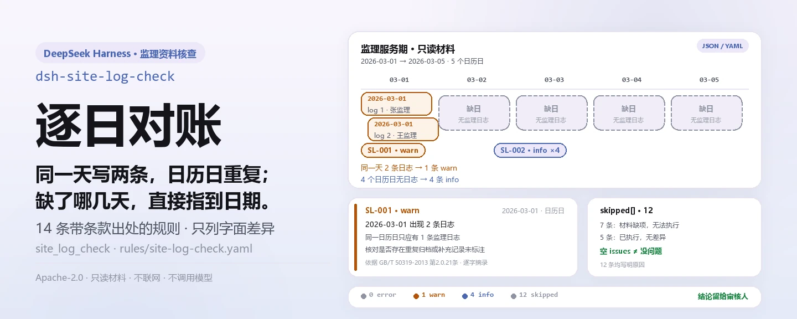
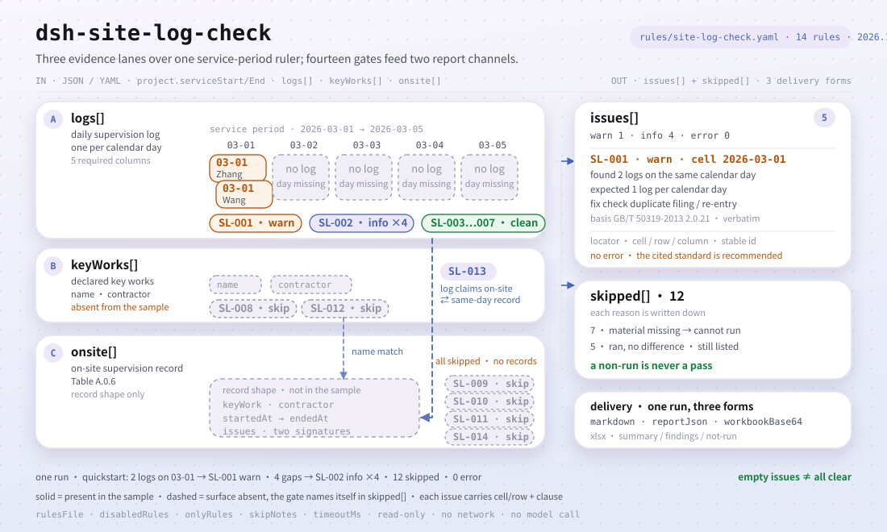

<div align="center">

<picture>
  <source media="(prefers-color-scheme: dark)" srcset="docs/assets/dsh-site-log-check-hero-zh-dark.webp">
  
</picture>

# dsh-site-log-check

**把监理日志的缺日、重复与旁站记录的漏项、对不上，逐条指到具体日期、具体栏目与所引条款。**

面向监理工程师与总监代表的 DeepSeek Harness 检查插件：读一份机器可读的监理资料导出，套用 14 条带条款出处的规则，只列字面差异——不下合规结论、不认定责任、不改原件。

[安装](#三步上手) · [配置](#配置) · [FAQ](#faq) · [简体中文](README.md) · [English](README.en.md) · [Español](README.es.md) · [Português](README.pt.md) · [हिन्दी](README.hi.md)

[](LICENSE)
[](#兼容性)
[](https://www.npmjs.com/package/dsh-site-log-check)
[](https://github.com/PerryLink/dsh-site-log-check/actions/workflows/ci.yml)
[](#兼容性)

[](https://github.com/PerryLink/dsh-site-log-check/stargazers)
[](https://www.npmjs.com/package/dsh-site-log-check)
[](https://dshfind.com/plugins/PerryLink/dsh-site-log-check?ref=badge)
[](https://securityscorecards.dev/viewer/?uri=github.com/PerryLink/dsh-site-log-check)
[](https://dsh.market/)
[](https://gitee.com/perrylink/dsh-site-log-check)

```sh
dsh plugin --profile <name> add dsh-site-log-check
```

</div>

<sub>社区插件，与 DeepSeek 官方无关。唯一仓库：<https://github.com/PerryLink/dsh-site-log-check>（Gitee 为镜像）。</sub>

## 它是什么

`dsh-site-log-check` 读取一个工程项目的监理资料——监理服务期、逐日监理日志、声明需要旁站的关键部位与关键工序清单、旁站记录——并按规则库引用的条款逐项核对：同一日历日是否出现两条以上日志、日志日期是否落在服务期内、服务期内哪些日子没有日志、每条日志是否填写了各项栏目与记录人、声明的旁站清单是否存在且每项都有对应的旁站记录、旁站记录是否填写了起止时间且先后顺序正确、关键部位与工序、施工单位、发现的问题及处理情况与签字，以及日志里声明的旁站当日是否有旁站记录对应。报出的都是字面差异，每条差异都带出它依据的条款，供人工复核。

**边界：** 本插件核对一个施工项目的**日常监理日志的连续性以及现场监理记录的覆盖情况**——即工程监理领域。它不是 `dsh-archive-check`（该插件核对项目记录在归档层面是否齐备），不是 `dsh-hazplan-check`（该插件核对危险性较大分部分项工程专项方案的章节），也不是现场安全检查员。它读取监理机构自身记录的机器可读导出，报出与所引条款之间的字面差异。

<picture>
  <source media="(prefers-color-scheme: dark)" srcset="docs/assets/dsh-site-log-check-flow-v5-dark.svg">
  
</picture>

## 三步上手

1. **安装**（三选一）：

   ```sh
   # npm 通道（已发布版本）
   dsh plugin --profile web add dsh-site-log-check
   # git 通道（最新 main；安装时执行 package.json#prepare 里的 tsdown 产出 lib/）
   dsh plugin --profile web add github:PerryLink/dsh-site-log-check
   # tarball 通道：本仓库 pnpm pack 后
   dsh plugin --profile web add ./dsh-site-log-check-<version>.tgz
   ```

   也可以在 WorkBuddy / 扣子搜「职业文档核对全集」（总包，本检查是其中一项；上架以商城为准）。

2. **最小配置**（默认即可用）：

   ```yaml
   - insert:
       - id: dsh-site-log-check
         name: dsh-site-log-check
   ```

   全部可调项都在 `src/config.ts` 的 Schemastery schema 里，逐条阈值在 `rules/site-log-check.yaml` 中。

3. **验证已生效**：

   ```sh
   dsh --profile <name> --dump-config | grep 'dsh-site-log-check'
   ```

   再用自带样例跑一次（约 1 分钟；样例脚本从 `lib/index.mjs` import，先构建）：

   ```sh
   pnpm install && pnpm run build
   node samples/quickstart/run.mjs
   ```

   ```text
   $ node samples/quickstart/run.mjs
   site_log_check: 5 issue(s) — error 0, warn 1, info 4
   skipped: 12
   ```

   样例输入在 `samples/quickstart/input/SL-001-unsafe.yaml`，期望输出在 `samples/quickstart/expected/result.json`；`node samples/quickstart/run.mjs --json` 给出同一份摘要的 JSON。

**卸载**：`dsh plugin --profile <name> remove dsh-site-log-check`（或从 profile patch 删掉该行）。

<details>
<summary>从 DSH Desktop 市场安装</summary>

所有 PerryLink 插件均可在 DSH Desktop 内置市场中浏览：**市场 → 来源 → 添加来源 → 粘贴** `https://perrylink-dsh-catalog.perrylink.workers.dev/catalog-source.json` **→ 选中**。安装仍需通过市场的 npm 身份校验与你的确认。

</details>

## 核心能力

`dsh-site-log-check` 注册 `site_log_check` 工具：读入一份监理资料（JSON 或 YAML），套用带版本的规则包，返回一份结构化报告——每条差异都带 `found` / `expected` / `fix` 与所引条款。

- **规则包即数据** —— 14 条规则全部在 `rules/site-log-check.yaml`；替换该文件即切换规则集，不用改 TypeScript。规则包在加载期校验，而不是被信任。
- **严重级跟着依据走** —— 依据为原则性条款（`derived-from-principle`）的规则封顶 `warn`；依据为本机构配置（`institutional-configuration`）的阈值封顶 `info`；绝不会把原则或本地配置标成 `error`（有测试断言）。
- **空清单不等于没问题** —— 每一项无法执行的检查都会在 `skipped` 里自报规则 id 与原因；必填清单未配置的规则自报 `skipped`，而不是静默通过。
- **不裁决** —— 报告只列差异，永不判定合规、责任或对错；措辞守卫拦下裁决用词，报告始终携带免责声明。
- **引文必须逐字** —— 每条规则带文件名、文号、按原文自身编号体系的条款号、逐字摘录（不少于八个字符）与来源链接；原文取不到时在摘录里明说，并把规则标为 `derived-from-principle`，绝不把转述包装成引文。
- **三种交付形态** —— 同一次检查同时给出 `markdown`（给模型读）、`reportJson`（机器可读）与 `workbookBase64`（xlsx：汇总 / 差异清单 / 未执行 三张工作表），可直接附在记录里存档。

```text
监理资料（服务期 · 日志 · 旁站清单 · 旁站记录）──site_log_check──▶ 规则包 SL-001…SL-014 ──▶ 报告（findings + skipped）
        ▲                                                                                          │
        └────────────────────────────── 只读输入，原件永不修改 ────────────────────────────────────┘
```

### 规则一览

| 规则 | 核对内容 | 严重级 | 依据 |
|---|---|---|---|
| `SL-001` | 同一日历日一条日志，且日期落在监理服务期内 | warn | GB/T 50319-2013 第2.0.21条 |
| `SL-002` | 服务期内不缺日 | info | GB/T 50319-2013 第2.0.21条 · DBJT 13-144-2019 7.1.1 |
| `SL-003` | 日志记录天气和施工环境 | warn | GB/T 50319-2013 第7.2.2条第1款 |
| `SL-004` | 日志记录当日施工进展 | warn | GB/T 50319-2013 第7.2.2条第2款 |
| `SL-005` | 日志记录当日监理工作 | warn | GB/T 50319-2013 第7.2.2条第3款 |
| `SL-006` | 日志记录当日存在的问题**及处理情况** | warn | GB/T 50319-2013 第7.2.2条第4款 |
| `SL-007` | 日志写明记录人 | warn | GB/T 50319-2013 第3.2.3条第10项 |
| `SL-008` | 工程有声明需旁站的关键部位、关键工序清单 | warn | GB/T 50319-2013 第5.2.11条 · 国务院令第279号第三十八条 |
| `SL-009` | 旁站记录有起止时间且先后顺序正确 | warn | GB/T 50319-2013 表A.0.6 |
| `SL-010` | 旁站记录写明发现的问题及处理情况 | warn | GB/T 50319-2013 表A.0.6 |
| `SL-011` | 旁站记录有签字，且不只有一方签字 | warn | GB/T 50319-2013 表A.0.6 · 建市〔2002〕189号第七条 |
| `SL-012` | 每项声明的关键部位与工序至少有一条旁站记录 | warn | 建市〔2002〕189号第二条、第九条 |
| `SL-013` | 日志里声明的旁站与旁站记录台账对得上 | warn | GB/T 50319-2013 第7.2.2条第3款 |
| `SL-014` | 旁站记录写明关键部位、关键工序与施工单位 | warn | GB/T 50319-2013 表A.0.6 |

本规则库没有 `error` 级规则，原因见「依据的标准」。

### 示例

以下为插件真实入口；安装后调用一次即可。

**详细输出** —— 工具 `site_log_check`，输入：

```yaml
project:
  serviceStart: "2026-03-01"
  serviceEnd: "2026-03-05"
logs:
  - date: "2026-03-01"
  - date: "2026-03-05"
```

输出：

```json
{
  "id": "dsh-site-log-check.SL-002.378ce636",
  "ruleId": "SL-002",
  "severity": "info",
  "locator": {
    "cell": "2026-03-02"
  },
  "found": "2026-03-02 无监理日志记录",
  "expected": "监理服务期 2026-03-01 ~ 2026-03-05 内应按日历日记录",
  "fix": "核对是否因停工、节假日或日志未归档；确无施工活动的应有说明"
}
```

*Observed from `dsh-site-log-check/tests/fixtures/SL-002/SL-002-unsafe.yaml`*

**简短示例**：`site_log_check` · `only: ["SL-001"]` · `rulesFile: rules/site-log-check.yaml`（可在调用时覆盖规则库，做一次性对比）。

### 它回答什么问题

| 你会问 | 它怎么答 |
|---|---|
| 两条日志写的是同一个日历日，会被报出来吗？ | 会。`SL-001` 按 `params.maxPerDay`（1）核对，同一日历日出现多条日志的逐日列出；日志日期落在 `project.serviceStart` 与 `project.serviceEnd` 所定监理服务期之外的也会报出。它只比日期和条数，不判断两条里哪条才是当日的记录，也不判断补记是否成立。材料中的日志日期全都无法识别时，本条报告无法执行，而不是静默通过。 |
| 服务期中间缺了三天日志，检查会怎么处理？ | `SL-002` 数出 `project.serviceStart` 到 `project.serviceEnd` 之间没有日志的日历日。它是本规则库唯一的 `info` 级规则：「页次、日期应连续」的明文出自福建省 DBJT 13-144-2019，不是 GB/T 50319-2013，所以只提示、不阻断。覆盖率低于 `params.minCoverageRatio`（0.9）时逐日列为差异；达到或高于该比例时，本条报告无法执行，并在其中列出缺日。缺日究竟因停工、节假日还是日志未归档，留给人核实。 |
| 某一天的日志，存在的问题那一栏空着。 | `SL-006` 会报出该条：每条日志都应填写当日存在的问题及处理情况。它只核对这一栏是否填写，不核对写的内容对不对，所以写明「未发现问题」可以通过，留空不行。规则库如实记录：第7.2.2条第4款两种来源的措辞不一致、官方件未能复核，因此本条有意不对措辞作判断，只看栏位是否填写。 |
| 材料里没有声明哪些关键部位、关键工序需要旁站，会静默通过吗？ | 不会。当材料显示确实涉及旁站（存在旁站记录，或某条日志的监理工作栏提到旁站）时，`SL-008` 报出缺少本工程旁站清单；如果没有任何涉及旁站的迹象，本条报告无法执行并说明缺清单，而不是为工程凭空设定一项可能并不适用的要求。规则库说明：GB/T 50319-2013 正文未列举这份清单，清单来源是建市〔2002〕189号第二条。 |
| 旁站记录只有旁站监理人员签字，施工企业现场质检人员没签，会报吗？ | 会。`params.requireContractorSignature` 打开时，`SL-011` 既报缺少旁站监理人员签字，也报缺少施工企业现场质检人员签字。规则库有意把两个依据分开：表 A.0.6 只有「旁站监理人员（签字）」一个签字栏，双方签字的依据是建市〔2002〕189号第七条，不得归给 GB/T 50319-2013。本条只核对签字是否留下，不核对签字是否真实。 |
| 日志写着 5 月 12 日旁站了，但旁站记录台账里当天没有记录。 | `SL-013` 会报出。它把监理工作栏提到旁站的日志日期，与旁站记录开始时间的日期相比对。它只核对两者是否对得上；规则库说明 GB/T 50319-2013 与建市〔2002〕189号 都没有要求两份材料编号互链。旁站记录都没有填写开始时间，或没有日志声明旁站情况时，本条报告无法执行，而不是静默通过。 |

## 配置

全部可调参数都在 `src/config.ts` 的 Schemastery schema 中，只改 `cordis.yml` 即可生效，无需改代码；逐条阈值在 `rules/` 下的规则库文件里。全部配置键即下表 5 个；规则级参数见表后。

| 键 | 类型 | 默认值 | 说明 |
|---|---|---|---|
| `rulesFile` | string | `rules/site-log-check.yaml` | 规则库文件路径，相对插件包根目录 |
| `disabledRules` | string[] | `[]` | 要停用的规则 id 列表；每条都会出现在 `skipped` 中 |
| `onlyRules` | string[] | `[]` | 只执行这些规则 id；留空表示执行全部规则 |
| `skipNotes` | string | `""` | 附加到每条 `skipped` 说明后的备注，例如标注本机构实施细则 |
| `timeoutMs` | number | `120000` | 工具协作式超时预算（毫秒） |

值得知道的规则级参数：

- `SL-001` `maxPerDay` —— 同一日历日允许的日志条数，默认 `1`。
- `SL-002` `minCoverageRatio`（默认 `0.9`）与 `ignoreWeekends`（默认 `false`）—— 覆盖率达标时本条只进 `skipped` 并列出缺日，不逐日列差异。
- `SL-009` `requireEndTime`（默认 `true`）—— 设为 `false` 则不再要求填写结束时间。
- `SL-011` `requireContractorSignature`（默认 `true`）—— 合同不适用双方签字要求时设为 `false`。
- `SL-012` `keyWorks` —— 需旁站的关键部位、关键工序清单，默认逐字取自建市〔2002〕189号第二条；该条只覆盖**房屋建筑工程**，其他专业工程按该办法第十二条「可以参照本办法实施」，请替换清单。

profile patch 覆盖示例：

```yaml
- insert:
    - id: dsh-site-log-check
      name: dsh-site-log-check
      config:
        onlyRules: [SL-001, SL-002]
        skipNotes: 本机构实施细则 2026 版
```

## FAQ

<details>
<summary>我的材料会被改动或上传吗？</summary>

不会。工具只读你交出的 JSON/YAML（`file` 或 `material`），**绝不修改原件**；插件是纯 ESM，无原生代码、**不联网、不调用模型**（见「兼容性」），`package.json#dsh.demo` 也声明了 `network: false` 与 `writes: []`。报告里的 xlsx 是 `workbookBase64` 字段，由你自己决定是否保存，插件不落盘。

</details>

<details>
<summary>空的差异清单，能当作「没问题」吗？</summary>

不能。空差异只表示**已执行**的规则没发现差异；无法执行的规则会在 `skipped` 里自报规则 id 与原因。自带样例就是现成的例子——两份日志、没有旁站清单与旁站记录，于是 1 条 `warn`、4 条 `info`，另有 12 条 `skipped`。报告始终携带免责声明，说明它不构成对任何事实、行为或文件的定性意见。

</details>

<details>
<summary>会和其他插件抢工具名、命令或路由吗？</summary>

不会。插件只注册一个带命名空间的工具 `site_log_check`，`inject` 只声明 `tools`；不提供服务键、不注册客户端 slot、不注册 `webServer` 路由，bundle patch 只 `insert` 自己一行，从不覆写内置行的 `config`。注册本身是 Cordis effect，卸载/热重载即撤销。

</details>

<details>
<summary>一整批工程的监理资料核起来，跑得动吗？</summary>

跑得动。检查核心是纯函数：读文件 + 14 条规则的字符串比较，无网络请求、无模型调用；`timeoutMs` 是协作式预算（默认 120000 毫秒）。工具在 `native` 与 `ptc` 两种模式下都可用，批量核对整个目录建议 `ptc`，schema 成本只付一次。

</details>

<details>
<summary>我们的地方标准或机构规定更严，能接进来吗？</summary>

能，改规则库不动代码：`rulesFile` 指向你自己的 YAML 即可。依据类型决定严重级上限——一般原则推论 `derived-from-principle` 封顶 `warn`，本机构阈值 `institutional-configuration` 封顶 `info`，规则库不会产出 `error`；摘录仍必须是逐字引文且不少于八个字符。

</details>

## 依据的标准

| 文件 | 文号 | 引用它的规则 |
|---|---|---|
| 《建设工程监理规范》 | GB/T 50319-2013 | SL-001, SL-002, SL-003, SL-004, SL-005, SL-006, SL-007, SL-008, SL-009, SL-010, SL-011, SL-013, SL-014 |
| 福建省《建设工程监理文件资料管理标准》 | DBJT 13-144-2019 | SL-002 |
| 《建设工程质量管理条例》 | 国务院令第279号 | SL-008 |
| 《房屋建筑工程施工旁站监理管理办法（试行）》 | 建市〔2002〕189号 | SL-011, SL-012 |

> ### ⚠️ 这里没有 `error`，因为标准是**推荐性**的
>
> **GB/T 50319-2013 是推荐性国家标准** —— 住房和城乡建设部公告第 35 号批准其为「国家标准，
> **编号为 GB/T 50319-2013**」，其前言**未声明任何章为强制性**。对比 **GB 26860—2011**，其前言
> 明写「第5章和7.3.4为推荐性，**其余为强制性**」。条文里的「应」是工程建设标准的起草惯例，
> **不等于法律强制**，因此每条规则最高只到 `warn`，**本插件不阻断任何流程**。
>
> 这不表示这些要求不重要：**监理日志与旁站监理是《建设工程质量管理条例》规定的法定义务**。
> 但承载此处所核*具体条款*的标准是推荐性的，所以只提示、不阻断。

## 材料格式

工具接受 JSON 或 YAML。字段在读取层是可选的，由检查引擎校验，因此部分导出的材料会产生「缺项」类差异，而不是让程序崩溃。

```yaml
target: 某住宅楼工程 监理日志与旁站记录
project:
  name: 某住宅楼工程
  serviceStart: "2026-03-01"
  serviceEnd: "2026-03-05"
logs:
  - date: "2026-03-01"
    weather: 晴，具备施工条件
    progress: 三层顶板钢筋绑扎完成 80%
    supervision: 巡视 2 次；旁站混凝土浇筑 1 次
    issues: 个别箍筋间距偏大，已要求班组整改并复查
    recorder: 张监理
keyWorks:
  - name: 土方回填
    contractor: 某基础工程公司
onsite:
  - id: PZ-0001
    keyWork: 混凝土浇筑
    contractor: 某建筑公司
    startedAt: "2026-03-04 08:00"
    endedAt: "2026-03-04 12:30"
    issues: 未发现问题；坍落度经检测符合要求
    supervisorSignature: 张监理
    contractorSignature: 李质检
```

- `project.serviceStart` / `project.serviceEnd` 决定监理服务期，`SL-001`、`SL-002`、`SL-013` 都以它为准。
- `logs[]` 的 `weather` / `progress` / `supervision` / `issues` / `recorder` 分别对应 `SL-003` 到 `SL-007`。
- `keyWorks[]` 是声明的旁站清单，`SL-008` 核对它是否存在、`SL-012` 核对每项是否有旁站记录。
- `onsite[]` 的 `startedAt` / `endedAt` 对应 `SL-009`，`issues` 对应 `SL-010`，两处签名对应 `SL-011`，`keyWork` / `contractor` 对应 `SL-014`。

## 规则来源

规则数据在 `rules/site-log-check.yaml`，与代码分离。每条规则携带文件名、文号、按原文自身编号体系的条款号、逐字摘录与来源链接。加载器强制：摘录必须是真实引文且不少于八个字符；依据仅为一般原则（`kind: derived-from-principle`，上限 `warn`）或本机构配置（`kind: institutional-configuration`，上限 `info`）的检查**永远不能**标为 `error`。夸大依据的规则库会在加载期失败，而不会产出一份看起来很有底气的报告。

条款号已对照《建设工程监理规范》GB/T 50319-2013 与《房屋建筑工程施工旁站监理管理办法（试行）》建市〔2002〕189号全文核对。三处核验结论塑造了本规则包，一并记在这里，供复核者看出哪些结论是**刻意没有**作出的：

1. **「每日连续」没有国家标准条文。** GB/T 50319-2013 只在监理日志的定义里写了「每日」（第2.0.21条）；「日期应连续」的明文出自福建省 DBJT 13-144-2019 这一**地方**标准，因此 `SL-002` 封顶为 `info`。
2. **双方签字不是 50319 的要求。** 表 A.0.6 只有一个签字栏「旁站监理人员（签字）」。要求施工企业质检人员也签字的是建市〔2002〕189号第七条，`SL-011` 把两份依据分别标注，而不是合并成一条。
3. **每日签字与总监签阅是地方要求。** 它们出自山东省 DB37/T 5009，不是国家标准，因此本规则包只核对是否留下记录人（`SL-007`），不虚构签字义务。

`SL-012` 里的关键工序清单也逐字对照过建市〔2002〕189号第二条。完整的条款核验记录（含经核查后被弃用的来源）见 `rules/evidence/`。

## 已知限制

- **只核对可机上判读的字面项。** 它不判断补记是否成立、缺日究竟因停工/节假日/日志未归档、签字是否真实、栏位里的内容写得对不对——这些留给人。
- **没有 `error` 级规则。** 承载此处所核具体条款的 GB/T 50319-2013 是推荐性国家标准，所以 14 条最高只到 `warn` 或 `info`；义务本身在《建设工程质量管理条例》第三十八条，做法在推荐性标准。
- **连续性阈值是本机构配置。** `SL-002` 的 `minCoverageRatio`（默认 `0.9`）在覆盖率达标时只把缺日列进 `skipped`，不逐日列差异；`ignoreWeekends` 默认 `false`，周末同样计入。
- **`SL-012` 的关键工序清单只适用房屋建筑工程。** 清单逐字取自建市〔2002〕189号第二条；其他专业工程按该办法第十二条「可以参照本办法实施」，需替换 `keyWorks`。
- **第7.2.2条第4款两种读法并存。** 「及处理情况」与「及协调解决情况」两种来源措辞不同，官方件本轮未能复核；`SL-006` 因此只看栏位是否填写，不对措辞作判断——这是核对范围的边界，不是「另一种读法有误」的断言。
- **「每日签字、总监签阅」不是国标要求。** 出自山东省 DB37/T 5009，本插件只核对是否留下记录人，不虚构签字义务。
- **日期是墙上时钟字符串运算。** 全部计算都是对输入字符串做墙上时钟运算，不做时区换算。

## 兼容性

| 项目 | 状态 |
|---|---|
| Harness | 对等版本范围 `>=0.1.2-rc.1 <0.2.0 \|\| >=0.2.0-0 <0.3.0` —— 已实测同时接受 `0.2.0-rc.2` 与 `0.2.1-rc.2`。已声明 `engines.dsh`：`>=0.2.1-0 <0.3.0`，0.2.1 起由宿主单独裁决 |
| Node | `^22.19.0 \|\| >=24.0.0` |
| 平台 | 全平台（纯 ESM；无原生代码、无联网、不调用模型） |
| 工具模式 | `native` / `ptc` 均可；批量校验整个目录时建议 `ptc`，schema 成本只付一次 |

## 故障排查

- **插件装上了但工具不出现。** 确认 `main` 指向 `lib/index.mjs` 且 `pnpm run build` 已生成该文件；`main` 写错会让加载器静默跳过该条目。
- **`dsh plugin add` 报版本不兼容。** peer 范围覆盖 `0.1.x` 与 `0.2.x`；若运行时在其之外，可显式豁免：`dsh plugin --profile <name> allow-version dsh-site-log-check@0.1.0 --dsh-version <runtime> --accept-risk`。
- **`SL-002` 什么也没报。** 覆盖率仍在 `minCoverageRatio` 之上，缺日列在该条 `skipped` 说明里；想把每个缺日都看成一条差异，把比例调低即可。
- **某条规则没有执行。** 查看报告末尾的「未执行的检查」，其中写明了规则 id 与原因（停用、清单未配置、无可用输入）。
- **`check` 报 `manifest-peers` 失败。** 静态检查器比对的是一份早于 0.2 世代的硬编码 peer 范围；安装期的 peer 校验以运行时为准，声明的范围才是正确的。这是 `dsh-plugin-dev` 的已知上游问题。
- **发现里写着条款原文未取得。** 规则库不伪造引文：取不到原文时严重级停在 `warn` / `info` 并在 `excerpt` 里说明，这属于核验缺口，不是「材料没问题」的证据。
- **时间看起来偏移。** 全部计算都是对输入字符串做墙上时钟运算，不做时区换算。

## 生态与质量

- [Gitee 镜像](https://gitee.com/perrylink/dsh-site-log-check)（同步镜像，以 GitHub 为准）
- [dshfind 插件页](https://dshfind.com/plugins/PerryLink/dsh-site-log-check)（安装量与排名）
- [OpenSSF Scorecard 报告](https://securityscorecards.dev/viewer/?uri=github.com/PerryLink/dsh-site-log-check)（由 [.github/workflows/scorecard.yml](.github/workflows/scorecard.yml) 驱动）
- [DSH Market](https://dsh.market/)（已上架）
- [生态实测知识库 · 按材料选核查器](https://perrylink.github.io/zh/checkers/choose/)（完整家族清单：62 个核查器 + 通用插件）

## 开发

```sh
pnpm install
pnpm run typecheck        # tsc --noEmit
pnpm test                 # vitest，每条规则配对正/反夹具（tests/fixtures/<RULE>/）
pnpm run build            # tsdown -> lib/index.mjs + lib/index.d.mts
pnpm run verify:self-contained   # 依赖 spec 均来自 registry
pnpm run check:lockfile   # pnpm-lock 未漂移
pnpm run check:readmes    # 五语 README 一致性
pnpm run check:citations  # 每条 excerpt（含 alsoBasis）都是逐字引文
pnpm pack                 # 发布 tarball
node ../scripts/sync-shared.mjs dsh-site-log-check   # 从 ../_shared 刷新 src/shared
```

目录布局：

| 路径 | 作用 |
|---|---|
| `src/index.ts` | 函数插件契约（`name` / `inject` / `Config` / `apply`）；注册 `site_log_check` 工具 |
| `src/config.ts` | Schemastery schema；所有可调项都在这里，没有硬编码阈值 |
| `src/check.ts` | 纯检查核心 `(input, ruleset, options) => Report`：无插件上下文、无 I/O、无时钟 |
| `src/parse.ts` | 读入材料（JSON 或 YAML） |
| `src/view.ts` | 报告对模型的投影；`output.schema` 与它对齐 |
| `src/shared/` | 共享件（规则集加载、报告结构、YAML 子集、日历运算、措辞守卫）；整份拷入以保持自包含 |
| `rules/site-log-check.yaml` | 规则包，14 条 |
| `rules/evidence/` | 每条引文的条款核验记录 |
| `tests/` | vitest；每条规则在 `tests/fixtures/<RULE>/` 下配对正/反夹具 |
| `samples/quickstart/` | 可复跑的快速样例（输入 + 期望输出） |

规则包是数据不是代码：改 `rules/*.yaml` 即切换规则集，无需动 TypeScript；规则包在加载期校验，而非被信任。README 配图由 [`scripts/gen-readme-assets.py`](scripts/gen-readme-assets.py) 程序化生成（Python + Pillow）：hero 为 1440×576 的四版 WebP（中英 × 深浅），结构图为手写 SVG（深浅双版），均可重复执行；本插件无 UI，图内只画材料面、规则闸与报告通道。

Topics：`dsh`, `dsh-plugin`, `deepseek-harness`, `deepseek`, `cordis`, `site`, `log`

## 家族与致谢

本项目是 [PerryLink](https://github.com/PerryLink) 维护的 DeepSeek Harness 插件家族成员（全部 Apache-2.0）。如果这个插件帮到了你，**给个 star**——它不解锁任何功能，但会让下一个人更容易找到它。

- [@PerryLink](https://github.com/PerryLink) —— 创建者与维护者：`site_log_check` 工具、逐字引文的规则包与条款核验记录（`rules/evidence/`）、五语文档。

<details>
<summary>展开全部插件</summary>

| 插件 | 状态 |
|---|---|
| **[dsh-aqua-input-check](https://github.com/PerryLink/dsh-aqua-input-check)** |  |
| **[dsh-archive-check](https://github.com/PerryLink/dsh-archive-check)** |  |
| **[dsh-auto-review](https://github.com/PerryLink/dsh-auto-review)** |  |
| **[dsh-autotier](https://github.com/PerryLink/dsh-autotier)** | 🧊 已冻结 — 见仓库 README |
| **[dsh-bid-ca-precheck](https://github.com/PerryLink/dsh-bid-ca-precheck)** |  |
| **[dsh-bid-qual-check](https://github.com/PerryLink/dsh-bid-qual-check)** |  |
| **[dsh-cert-mcp](https://github.com/PerryLink/dsh-cert-mcp)** | 🧊 已冻结 — 见仓库 README |
| **[dsh-checkpoint-rewind](https://github.com/PerryLink/dsh-checkpoint-rewind)** |  |
| **[dsh-click](https://github.com/PerryLink/dsh-click)** |  |
| **[dsh-composer-history](https://github.com/PerryLink/dsh-composer-history)** |  |
| **[dsh-contract-stance](https://github.com/PerryLink/dsh-contract-stance)** |  |
| **[dsh-customs-doc-check](https://github.com/PerryLink/dsh-customs-doc-check)** |  |
| **[dsh-data-quality](https://github.com/PerryLink/dsh-data-quality)** | 🧊 已冻结 — 见仓库 README |
| **[dsh-demurrage-ledger](https://github.com/PerryLink/dsh-demurrage-ledger)** |  |
| **[dsh-doublecheck](https://github.com/PerryLink/dsh-doublecheck)** |  |
| **[dsh-drill-script-check](https://github.com/PerryLink/dsh-drill-script-check)** |  |
| **[dsh-eia-guide-check](https://github.com/PerryLink/dsh-eia-guide-check)** |  |
| **[dsh-emergency-plan](https://github.com/PerryLink/dsh-emergency-plan)** |  |
| **[dsh-essay-rubric-check](https://github.com/PerryLink/dsh-essay-rubric-check)** |  |
| **[dsh-evidence-check](https://github.com/PerryLink/dsh-evidence-check)** |  |
| **[dsh-export-ctl-check](https://github.com/PerryLink/dsh-export-ctl-check)** |  |
| **[dsh-fast](https://github.com/PerryLink/dsh-fast)** |  |
| **[dsh-fmea-table-check](https://github.com/PerryLink/dsh-fmea-table-check)** |  |
| **[dsh-forecast-penalty](https://github.com/PerryLink/dsh-forecast-penalty)** |  |
| **[dsh-fund-research](https://github.com/PerryLink/dsh-fund-research)** |  |
| **[dsh-github](https://github.com/PerryLink/dsh-github)** |  |
| **[dsh-gongwen-flow-check](https://github.com/PerryLink/dsh-gongwen-flow-check)** |  |
| **[dsh-gongwen-word-check](https://github.com/PerryLink/dsh-gongwen-word-check)** |  |
| **[dsh-guard-plan-qc](https://github.com/PerryLink/dsh-guard-plan-qc)** |  |
| **[dsh-hazchem-check](https://github.com/PerryLink/dsh-hazchem-check)** |  |
| **[dsh-hazplan-check](https://github.com/PerryLink/dsh-hazplan-check)** |  |
| **[dsh-hidden-risk-map](https://github.com/PerryLink/dsh-hidden-risk-map)** |  |
| **[dsh-hs-classify](https://github.com/PerryLink/dsh-hs-classify)** |  |
| **[dsh-icd-rule-check](https://github.com/PerryLink/dsh-icd-rule-check)** |  |
| **[dsh-industry-research](https://github.com/PerryLink/dsh-industry-research)** |  |
| **[dsh-lawcite-adapter](https://github.com/PerryLink/dsh-lawcite-adapter)** |  |
| **[dsh-laya](https://github.com/PerryLink/dsh-laya)** |  |
| **[dsh-lc-doc-check](https://github.com/PerryLink/dsh-lc-doc-check)** |  |
| **[dsh-learning-gap-check](https://github.com/PerryLink/dsh-learning-gap-check)** |  |
| **[dsh-library](https://github.com/PerryLink/dsh-library)** |  |
| **[dsh-local-ai](https://github.com/PerryLink/dsh-local-ai)** |  |
| **[dsh-lsp-actions](https://github.com/PerryLink/dsh-lsp-actions)** |  |
| **[dsh-mask](https://github.com/PerryLink/dsh-mask)** |  |
| **[dsh-mcp-panel](https://github.com/PerryLink/dsh-mcp-panel)** |  |
| **[dsh-medrec-qc](https://github.com/PerryLink/dsh-medrec-qc)** |  |
| **[dsh-memento](https://github.com/PerryLink/dsh-memento)** | 🧊 已冻结 — 见仓库 README |
| **[dsh-nsfc-form-check](https://github.com/PerryLink/dsh-nsfc-form-check)** |  |
| **[dsh-nurse-record-check](https://github.com/PerryLink/dsh-nurse-record-check)** |  |
| **[dsh-observe](https://github.com/PerryLink/dsh-observe)** |  |
| **[dsh-origin-rvc-check](https://github.com/PerryLink/dsh-origin-rvc-check)** |  |
| **[dsh-ota-review-check](https://github.com/PerryLink/dsh-ota-review-check)** |  |
| **[dsh-output-styles](https://github.com/PerryLink/dsh-output-styles)** |  |
| **[dsh-paper-doc-adapter](https://github.com/PerryLink/dsh-paper-doc-adapter)** |  |
| **[dsh-permission-rules](https://github.com/PerryLink/dsh-permission-rules)** |  |
| **[dsh-permit-report-check](https://github.com/PerryLink/dsh-permit-report-check)** |  |
| **[dsh-pipeline-check](https://github.com/PerryLink/dsh-pipeline-check)** |  |
| **[dsh-pleading-draft](https://github.com/PerryLink/dsh-pleading-draft)** |  |
| **[dsh-plugin-doctor](https://github.com/PerryLink/dsh-plugin-doctor)** | 🚫 已退役（仓库已归档） |
| **[dsh-plugin-guide](https://github.com/PerryLink/dsh-plugin-guide)** |  |
| **[dsh-plugin-kit](https://github.com/PerryLink/dsh-plugin-kit)** | 🚫 已退役（仓库已归档） |
| **[dsh-plugin-upgrade](https://github.com/PerryLink/dsh-plugin-upgrade)** | 🚫 已退役（仓库已归档） |
| **[dsh-policy-brief-draft](https://github.com/PerryLink/dsh-policy-brief-draft)** |  |
| **[dsh-power-loss-split](https://github.com/PerryLink/dsh-power-loss-split)** |  |
| **[dsh-power-ticket-check](https://github.com/PerryLink/dsh-power-ticket-check)** |  |
| **[dsh-ppap-check](https://github.com/PerryLink/dsh-ppap-check)** |  |
| **[dsh-protest-deadline](https://github.com/PerryLink/dsh-protest-deadline)** |  |
| **[dsh-railway-window](https://github.com/PerryLink/dsh-railway-window)** |  |
| **[dsh-repair-order-qc](https://github.com/PerryLink/dsh-repair-order-qc)** |  |
| **[dsh-research-report](https://github.com/PerryLink/dsh-research-report)** |  |
| **[dsh-review-reply-check](https://github.com/PerryLink/dsh-review-reply-check)** |  |
| **[dsh-rulefile-check](https://github.com/PerryLink/dsh-rulefile-check)** |  |
| **[dsh-safety-brief-check](https://github.com/PerryLink/dsh-safety-brief-check)** |  |
| **[dsh-score](https://github.com/PerryLink/dsh-score)** | 🧊 已冻结 — 见仓库 README |
| **[dsh-session-sync](https://github.com/PerryLink/dsh-session-sync)** |  |
| **[dsh-site-log-check](https://github.com/PerryLink/dsh-site-log-check)** |  |
| **[dsh-skill-pack-security](https://github.com/PerryLink/dsh-skill-pack-security)** |  |
| **[dsh-soe-decision-check](https://github.com/PerryLink/dsh-soe-decision-check)** |  |
| **[dsh-soilwater-check](https://github.com/PerryLink/dsh-soilwater-check)** |  |
| **[dsh-sop-sync-check](https://github.com/PerryLink/dsh-sop-sync-check)** |  |
| **[dsh-spc-gbt-adapter](https://github.com/PerryLink/dsh-spc-gbt-adapter)** |  |
| **[dsh-talk](https://github.com/PerryLink/dsh-talk)** |  |
| **[dsh-tender-extract](https://github.com/PerryLink/dsh-tender-extract)** |  |
| **[dsh-tender-matrix](https://github.com/PerryLink/dsh-tender-matrix)** |  |
| **[dsh-test-drive](https://github.com/PerryLink/dsh-test-drive)** |  |
| **[dsh-ticktick](https://github.com/PerryLink/dsh-ticktick)** | 🚫 已退役（仓库已归档） |
| **[dsh-translate](https://github.com/PerryLink/dsh-translate)** |  |
| **[dsh-warranty-calc](https://github.com/PerryLink/dsh-warranty-calc)** |  |
| **[dsh-budget](https://github.com/PerryLink/dsh-budget)** | 🧊 已冻结 — 见仓库 README |
| **[dsh-claude-move](https://github.com/PerryLink/dsh-claude-move)** | 🧊 已冻结 — 见仓库 README |
| **[dsh-defend](https://github.com/PerryLink/dsh-defend)** | 🧊 已冻结 — 见仓库 README |
| **[dsh-draw](https://github.com/PerryLink/dsh-draw)** | 🧊 已冻结 — 见仓库 README |
| **[dsh-reach](https://github.com/PerryLink/dsh-reach)** | 🧊 已冻结 — 见仓库 README |
| **[dsh-background-agents](https://github.com/PerryLink/dsh-background-agents)** | 🚫 已退役（仓库已归档） |
| **[dsh-session-pin](https://github.com/PerryLink/dsh-session-pin)** | 🚫 已退役（仓库已归档） |
| **[dsh-team-rooms](https://github.com/PerryLink/dsh-team-rooms)** | 🚫 已退役（仓库已归档） |

</details>

## License

[LICENSE](LICENSE)（Apache License 2.0）© 2026 dsh-site-log-check contributors

<p align="center"><sub>Apache-2.0 · 社区插件，与 DeepSeek 无关。</sub></p>
